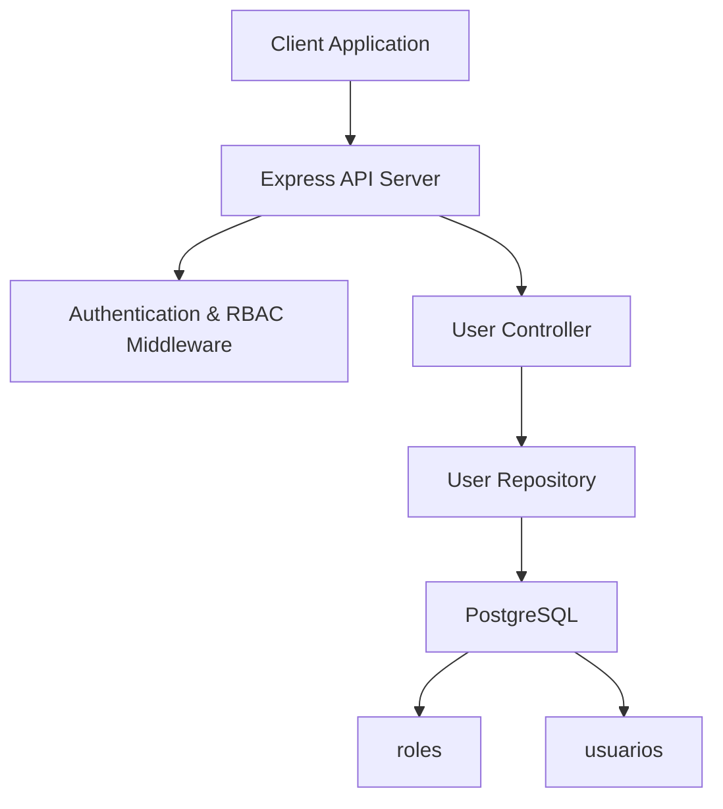
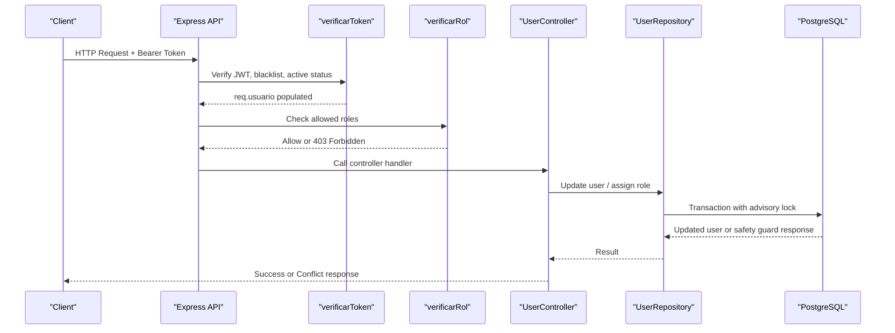
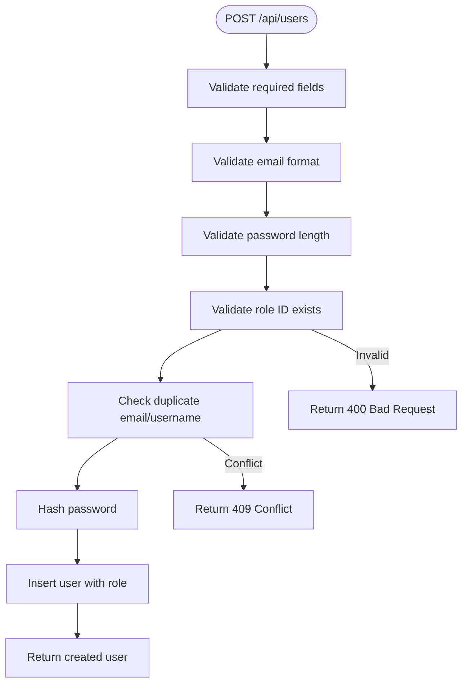
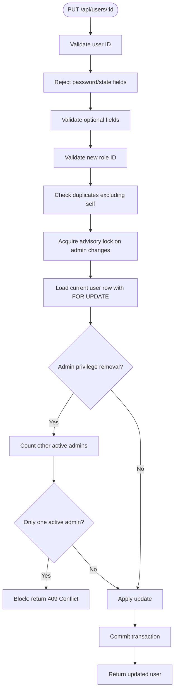
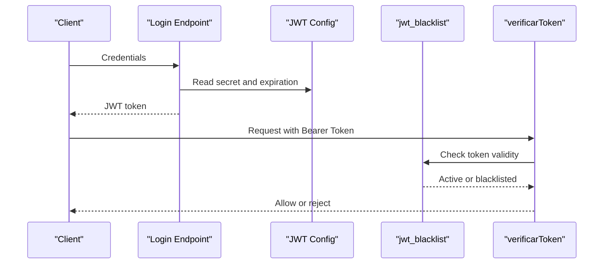
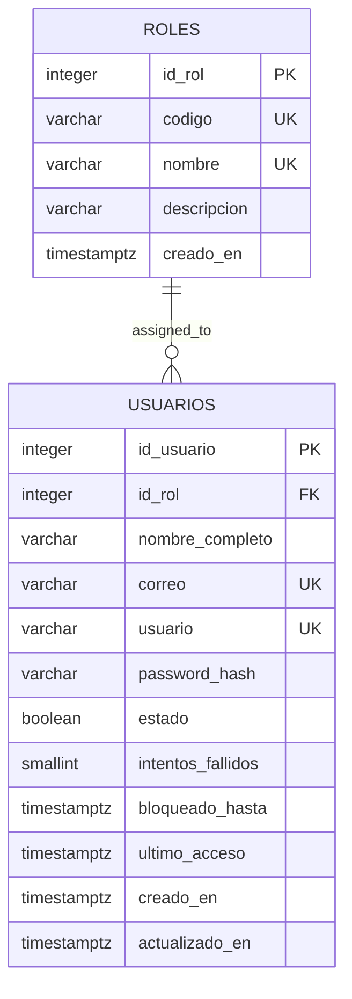
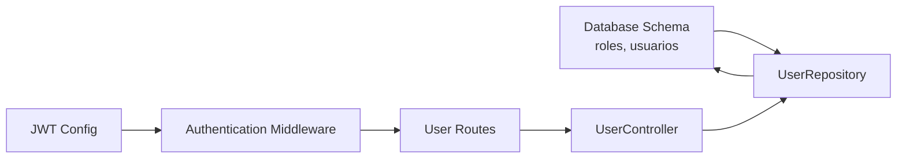

# Role and Permission Management

<cite>
**Referenced Files in This Document**   
- [002_seguridad.sql](file://backend/db/migrations/002_seguridad.sql)
- [001_rol_aplicacion.sql](file://backend/db/roles/001_rol_aplicacion.sql)
- [authMiddleware.js](file://backend/middleware/authMiddleware.js)
- [usuarios.controller.js](file://backend/src/controllers/usuarios.controller.js)
- [usuarios.repository.js](file://backend/src/repositories/usuarios.repository.js)
- [usuarios.routes.js](file://backend/src/routes/usuarios.routes.js)
- [jwt.js](file://backend/src/config/jwt.js)
- [index.js](file://backend/index.js)
</cite>

## Table of Contents
1. [Introduction](#introduction)
2. [Project Structure](#project-structure)
3. [Core Components](#core-components)
4. [Architecture Overview](#architecture-overview)
5. [Detailed Component Analysis](#detailed-component-analysis)
6. [Dependency Analysis](#dependency-analysis)
7. [Performance Considerations](#performance-considerations)
8. [Troubleshooting Guide](#troubleshooting-guide)
9. [Conclusion](#conclusion)

## Introduction
This document explains the role-based access control (RBAC) system used by the application. It covers the predefined roles, how permissions are enforced through middleware, how roles are assigned during user creation and updated via the `PUT /api/users/:id` endpoint, and how the authentication layer integrates with RBAC. It also documents the database schema for roles and users, including constraints and referential integrity rules that protect the system from losing all active administrators.

## Project Structure
The RBAC implementation spans several layers:
- Database migrations define the roles table, the users table, and their relationships.
- The authentication middleware validates JWT tokens and enforces role checks.
- The user controller handles input validation, role assignment, and protection against removing admin privileges from the last active administrator.
- The user repository performs transactional updates with advisory locks to prevent race conditions.
- Routes declare which roles can call each endpoint.

**Diagram sources**
- [authMiddleware.js:9-75](file://backend/middleware/authMiddleware.js#L9-L75)
- [usuarios.controller.js:29-294](file://backend/src/controllers/usuarios.controller.js#L29-L294)
- [usuarios.repository.js:115-229](file://backend/src/repositories/usuarios.repository.js#L115-L229)
- [002_seguridad.sql:15-60](file://backend/db/migrations/002_seguridad.sql#L15-L60)

**Section sources**
- [002_seguridad.sql:15-60](file://backend/db/migrations/002_seguridad.sql#L15-L60)
- [authMiddleware.js:9-75](file://backend/middleware/authMiddleware.js#L9-L75)
- [usuarios.controller.js:29-294](file://backend/src/controllers/usuarios.controller.js#L29-L294)
- [usuarios.repository.js:115-229](file://backend/src/repositories/usuarios.repository.js#L115-L229)

## Core Components
- Predefined roles: ADMIN, GERENTE, INVENTARIO, VENDEDOR.
- Authentication: JWT verification, session blacklist check, and immediate invalidation when a user is deactivated.
- Authorization: Role-checking middleware accepts either numeric role IDs or role codes.
- User management: Creation and update endpoints validate roles, enforce uniqueness, and protect the last active administrator.
- Database schema: Roles and users with strong constraints and referential integrity.

Key responsibilities:
- `authMiddleware.js`: Verifies tokens and enforces allowed roles per route.
- `usuarios.controller.js`: Validates inputs, assigns roles, and returns safe error responses.
- `usuarios.repository.js`: Performs secure, transactional updates with advisory locks.
- `002_seguridad.sql`: Defines roles, users, constraints, indexes, and triggers.

**Section sources**
- [authMiddleware.js:9-75](file://backend/middleware/authMiddleware.js#L9-L75)
- [usuarios.controller.js:29-294](file://backend/src/controllers/usuarios.controller.js#L29-L294)
- [usuarios.repository.js:115-229](file://backend/src/repositories/usuarios.repository.js#L115-L229)
- [002_seguridad.sql:15-60](file://backend/db/migrations/002_seguridad.sql#L15-L60)

## Architecture Overview
The RBAC flow combines authentication and authorization:
1. A client sends a request with a JWT token.
2. The authentication middleware verifies the token signature, checks if it has been blacklisted, and ensures the user is active.
3. The role-checking middleware compares the user’s role ID or role code against the route’s allowed roles.
4. If authorized, the request reaches the controller and repository logic.
5. For sensitive operations like changing roles or deactivating users, the repository uses advisory locks to avoid race conditions.

**Diagram sources**
- [authMiddleware.js:9-75](file://backend/middleware/authMiddleware.js#L9-L75)
- [usuarios.controller.js:172-254](file://backend/src/controllers/usuarios.controller.js#L172-L254)
- [usuarios.repository.js:115-172](file://backend/src/repositories/usuarios.repository.js#L115-L172)

## Detailed Component Analysis

### Predefined Roles and Permissions
The system defines four stable role codes:
- ADMIN: Full administrative access, including user management and audit visibility.
- GERENTE: Business oversight, dashboard and inventory valuation access, and authorization capabilities.
- INVENTARIO: Catalog, warehouse entries, transfers, adjustments, and alerts.
- VENDEDOR: Sales and customer management, order lifecycle handling.

These codes are stored in the `roles` table and are referenced by the JWT payload and RBAC middleware. Route-level authorization uses either numeric role IDs or these role codes.

**Section sources**
- [002_seguridad.sql:15-31](file://backend/db/migrations/002_seguridad.sql#L15-L31)
- [authMiddleware.js:52-75](file://backend/middleware/authMiddleware.js#L52-L75)
- [usuarios.routes.js:9-15](file://backend/src/routes/usuarios.routes.js#L9-L15)

### Role Assignment During User Creation
When creating a user:
- Required fields include role identifier, full name, email, username, and password.
- Email format and minimum password length are validated.
- The role ID is validated against the database to ensure it exists.
- Duplicate email or username conflicts are detected before insertion.
- The password is hashed securely before storage.
- On success, the created user includes public fields joined with the role information.

**Diagram sources**
- [usuarios.controller.js:29-84](file://backend/src/controllers/usuarios.controller.js#L29-L84)
- [usuarios.repository.js:25-36](file://backend/src/repositories/usuarios.repository.js#L25-L36)

**Section sources**
- [usuarios.controller.js:29-84](file://backend/src/controllers/usuarios.controller.js#L29-L84)
- [usuarios.repository.js:25-36](file://backend/src/repositories/usuarios.repository.js#L25-L36)

### Updating Roles Through PUT /api/users/:id
The update endpoint allows optional changes to role, full name, email, and username:
- Password and state fields are explicitly rejected here; they have dedicated flows.
- Each field is validated for type, length, and format.
- Role ID is validated against the database.
- Duplicate email or username across other users is prevented.
- If the change would remove admin privileges from the last active administrator, the operation is blocked with a conflict response.
- The repository performs the update inside a transaction with an advisory lock to prevent concurrent admin removals.

**Diagram sources**
- [usuarios.controller.js:172-254](file://backend/src/controllers/usuarios.controller.js#L172-L254)
- [usuarios.repository.js:115-172](file://backend/src/repositories/usuarios.repository.js#L115-L172)

**Section sources**
- [usuarios.controller.js:172-254](file://backend/src/controllers/usuarios.controller.js#L172-L254)
- [usuarios.repository.js:115-172](file://backend/src/repositories/usuarios.repository.js#L115-L172)

### Security Implications of Role Changes
- Preventing loss of admin access: Both role changes and deactivation paths block operations that would leave zero active administrators.
- Concurrency safety: Advisory locks serialize critical admin-related changes so two simultaneous requests cannot create a deadlock or inconsistent state.
- Immediate effect: Deactivating a user invalidates their access immediately, even if their JWT has not expired.
- Least privilege: The application database role (`simo_app`) is restricted from modifying certain catalog tables and audit logs.

**Section sources**
- [usuarios.repository.js:115-172](file://backend/src/repositories/usuarios.repository.js#L115-L172)
- [usuarios.repository.js:178-229](file://backend/src/repositories/usuarios.repository.js#L178-L229)
- [authMiddleware.js:29-49](file://backend/middleware/authMiddleware.js#L29-L49)
- [001_rol_aplicacion.sql:21-45](file://backend/db/roles/001_rol_aplicacion.sql#L21-L45)

### Role Validation Logic and Permission Checks
- Role existence validation: When assigning a role during creation or update, the system queries the `roles` table to confirm the role ID exists.
- Role code validation: Query filters accept role codes such as ADMIN, GERENTE, INVENTARIO, VENDEDOR, enforcing a strict pattern.
- Middleware permission checks: Routes use the role-checking middleware to allow only permitted roles. It accepts both numeric role IDs and role codes.

Examples of where this occurs:
- Role existence check during user creation and update.
- Role code validation in user listing filters.
- Route-level authorization using numeric IDs or role codes.

**Section sources**
- [usuarios.controller.js:51-53](file://backend/src/controllers/usuarios.controller.js#L51-L53)
- [usuarios.controller.js:213-218](file://backend/src/controllers/usuarios.controller.js#L213-L218)
- [usuarios.controller.js:113-118](file://backend/src/controllers/usuarios.controller.js#L113-L118)
- [authMiddleware.js:52-75](file://backend/middleware/authMiddleware.js#L52-L75)
- [usuarios.routes.js:9-15](file://backend/src/routes/usuarios.routes.js#L9-L15)

### Integration with Authentication System
- JWT configuration centralizes secret and expiration settings.
- Login issues are handled with consistent error responses.
- Logout adds the token to a blacklist; subsequent requests are rejected.
- Authentication middleware populates `req.usuario` with identity data, including role ID and role code, enabling RBAC checks downstream.

**Diagram sources**
- [jwt.js:1-15](file://backend/src/config/jwt.js#L1-L15)
- [index.js:428-458](file://backend/index.js#L428-L458)
- [authMiddleware.js:9-49](file://backend/middleware/authMiddleware.js#L9-L49)

**Section sources**
- [jwt.js:1-15](file://backend/src/config/jwt.js#L1-L15)
- [index.js:428-458](file://backend/index.js#L428-L458)
- [authMiddleware.js:9-49](file://backend/middleware/authMiddleware.js#L9-L49)

### Database Schema for Roles and User-Role Relationships
The security migration defines:
- `roles`: Stable role identifiers (`codigo`) and display names (`nombre`).
- `usuarios`: User records linked to roles via a foreign key, with constraints ensuring valid emails, usernames, and states.
- Indexes on role and state columns improve query performance.
- Triggers maintain updated timestamps.

Constraints and integrity:
- `roles.codigo` is unique and normalized to uppercase.
- `usuarios.id_rol` references `roles.id_rol` with restrict delete behavior.
- Unique constraints on email and username prevent duplicates.
- State defaults to active and supports temporary blocking fields.

**Diagram sources**
- [002_seguridad.sql:15-60](file://backend/db/migrations/002_seguridad.sql#L15-L60)

**Section sources**
- [002_seguridad.sql:15-60](file://backend/db/migrations/002_seguridad.sql#L15-L60)

## Dependency Analysis
The RBAC system depends on:
- Database schema for roles and users.
- JWT configuration for signing and verifying tokens.
- Authentication middleware for session validation and role extraction.
- Controllers and repositories for business logic and data integrity.
- Routes for declaring allowed roles per endpoint.

**Diagram sources**
- [002_seguridad.sql:15-60](file://backend/db/migrations/002_seguridad.sql#L15-L60)
- [jwt.js:1-15](file://backend/src/config/jwt.js#L1-L15)
- [authMiddleware.js:9-75](file://backend/middleware/authMiddleware.js#L9-L75)
- [usuarios.routes.js:9-15](file://backend/src/routes/usuarios.routes.js#L9-L15)
- [usuarios.controller.js:29-294](file://backend/src/controllers/usuarios.controller.js#L29-L294)
- [usuarios.repository.js:115-229](file://backend/src/repositories/usuarios.repository.js#L115-L229)

**Section sources**
- [002_seguridad.sql:15-60](file://backend/db/migrations/002_seguridad.sql#L15-L60)
- [jwt.js:1-15](file://backend/src/config/jwt.js#L1-L15)
- [authMiddleware.js:9-75](file://backend/middleware/authMiddleware.js#L9-L75)
- [usuarios.routes.js:9-15](file://backend/src/routes/usuarios.routes.js#L9-L15)
- [usuarios.controller.js:29-294](file://backend/src/controllers/usuarios.controller.js#L29-L294)
- [usuarios.repository.js:115-229](file://backend/src/repositories/usuarios.repository.js#L115-L229)

## Performance Considerations
- Indexes on `usuarios.id_rol` and `usuarios.estado` support efficient filtering and role-based queries.
- Advisory locks serialize critical admin-related updates, preventing race conditions at the cost of slight serialization under heavy concurrency.
- Pagination and controlled limits reduce load when listing users.
- Avoid returning sensitive fields like password hashes in API responses.

[No sources needed since this section provides general guidance]

## Troubleshooting Guide
Common issues and resolutions:
- Unauthorized or forbidden responses:
  - Missing or malformed JWT token results in unauthorized errors.
  - Expired or blacklisted tokens are rejected.
  - Inactive users are denied access immediately.
  - Insufficient role permissions result in forbidden responses.
- Conflict responses during user updates:
  - Attempting to remove admin privileges from the last active administrator is blocked.
  - Duplicate email or username across different users is rejected.
- Internal server errors:
  - Unexpected database or processing errors should be logged and investigated.

Operational tips:
- Ensure the JWT secret is configured securely in production.
- Monitor the blacklist table for logout behavior.
- Review advisory lock contention if many admin changes occur concurrently.

**Section sources**
- [authMiddleware.js:9-49](file://backend/middleware/authMiddleware.js#L9-L49)
- [usuarios.controller.js:237-242](file://backend/src/controllers/usuarios.controller.js#L237-L242)
- [usuarios.controller.js:278-283](file://backend/src/controllers/usuarios.controller.js#L278-L283)
- [index.js:428-458](file://backend/index.js#L428-L458)

## Conclusion
The RBAC system in this project provides a robust framework for managing roles and permissions. It enforces strict validation, protects against losing admin access, and integrates tightly with authentication via JWT. The database schema ensures referential integrity and performance through indexes, while middleware and controllers provide clear separation of concerns. Together, these components deliver secure, predictable access control aligned with the application’s business roles.

[No sources needed since this section summarizes without analyzing specific files]