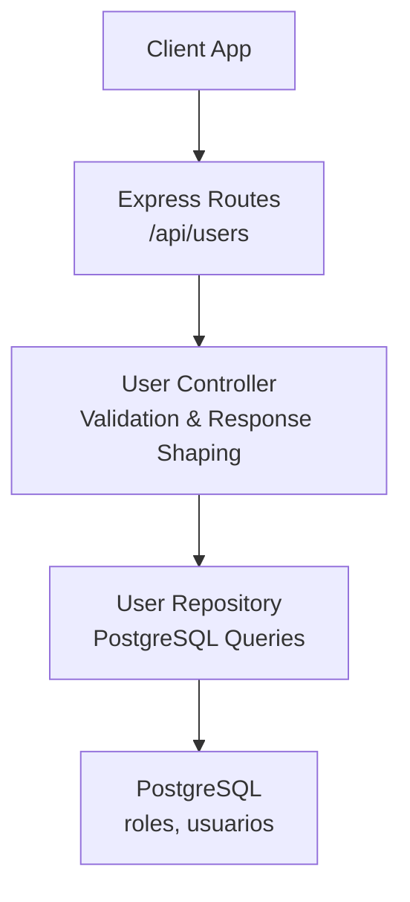
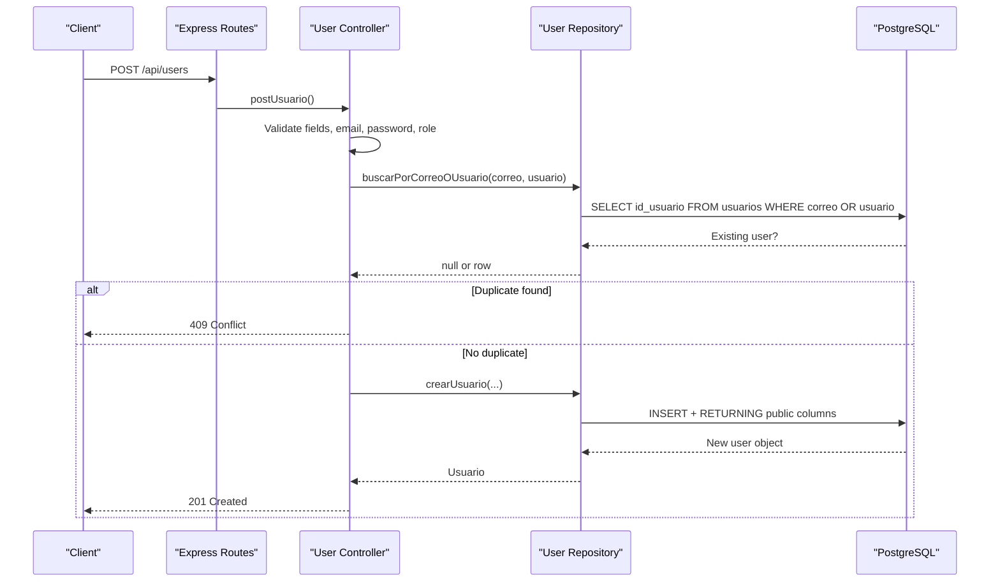
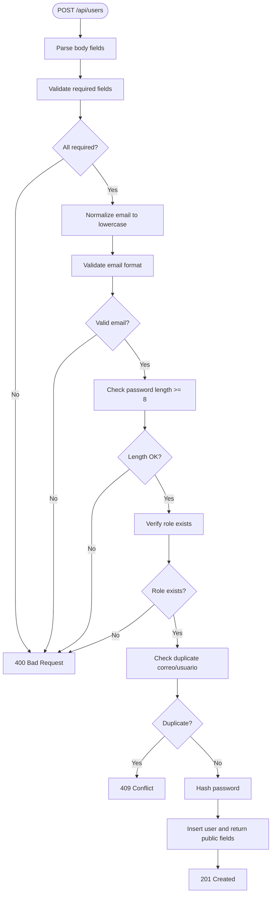
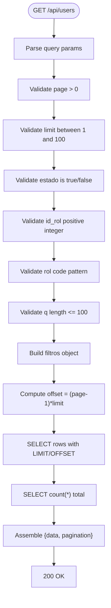
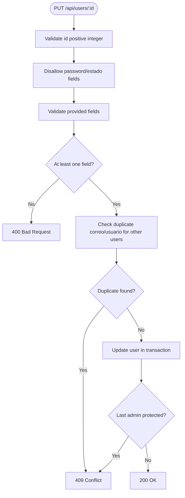
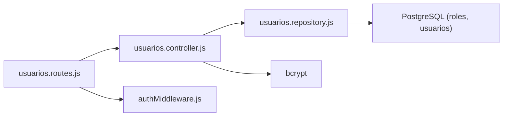

# User CRUD Operations

<cite>
**Referenced Files in This Document**
- [usuarios.controller.js](file://backend/src/controllers/usuarios.controller.js)
- [usuarios.repository.js](file://backend/src/repositories/usuarios.repository.js)
- [usuarios.routes.js](file://backend/src/routes/usuarios.routes.js)
- [002_seguridad.sql](file://backend/db/migrations/002_seguridad.sql)
- [usuarios.test.js](file://backend/tests/integracion/usuarios.test.js)
</cite>

## Table of Contents
1. [Introduction](#introduction)
2. [Project Structure](#project-structure)
3. [Core Components](#core-components)
4. [Architecture Overview](#architecture-overview)
5. [Detailed Component Analysis](#detailed-component-analysis)
6. [Dependency Analysis](#dependency-analysis)
7. [Performance Considerations](#performance-considerations)
8. [Troubleshooting Guide](#troubleshooting-guide)
9. [Conclusion](#conclusion)

## Introduction
This document explains the complete user lifecycle in the SIMO system: creation, retrieval, updating, and deactivation. It focuses on the REST endpoints under `/api/users`, including validation rules, pagination, filtering, conflict handling, and repository-layer database operations. The implementation uses a layered architecture with Express routes, a controller for request validation and response shaping, and a repository layer for data access.

## Project Structure
The user feature is implemented across three main layers:
- Routes define HTTP endpoints and apply authentication/authorization middleware.
- Controllers validate input, enforce business rules, and return standardized responses.
- Repositories encapsulate SQL queries and transactional logic against PostgreSQL.

**Diagram sources**
- [usuarios.routes.js:9-15](file://backend/src/routes/usuarios.routes.js#L9-L15)
- [usuarios.controller.js:29-294](file://backend/src/controllers/usuarios.controller.js#L29-L294)
- [usuarios.repository.js:12-230](file://backend/src/repositories/usuarios.repository.js#L12-L230)
- [002_seguridad.sql:15-60](file://backend/db/migrations/002_seguridad.sql#L15-L60)

**Section sources**
- [usuarios.routes.js:1-18](file://backend/src/routes/usuarios.routes.js#L1-L18)
- [usuarios.controller.js:1-295](file://backend/src/controllers/usuarios.controller.js#L1-L295)
- [usuarios.repository.js:1-242](file://backend/src/repositories/usuarios.repository.js#L1-L242)
- [002_seguridad.sql:1-91](file://backend/db/migrations/002_seguridad.sql#L1-L91)

## Core Components
- POST /api/users: Create a new user with strict validation (email format, password length, role existence, duplicate checks).
- GET /api/users: List users with pagination and filters (estado, id_rol, rol code, search text).
- GET /api/users/:id: Retrieve a single user by ID.
- PUT /api/users/:id: Partial update with field validation and conflict resolution.
- PATCH /api/users/:id/status or /api/users/:id/estado: Activate or deactivate a user safely.

Key behaviors:
- Passwords are hashed before storage; they are never returned in API responses.
- Email addresses are normalized to lowercase and validated with a regex.
- Role assignment requires an existing role ID and supports role codes for filtering.
- Duplicate email/username checks prevent conflicts at both application and database levels.
- Pagination returns total count and computed totalPages.

**Section sources**
- [usuarios.controller.js:29-84](file://backend/src/controllers/usuarios.controller.js#L29-L84)
- [usuarios.controller.js:90-143](file://backend/src/controllers/usuarios.controller.js#L90-L143)
- [usuarios.controller.js:148-164](file://backend/src/controllers/usuarios.controller.js#L148-L164)
- [usuarios.controller.js:172-255](file://backend/src/controllers/usuarios.controller.js#L172-L255)
- [usuarios.controller.js:263-292](file://backend/src/controllers/usuarios.controller.js#L263-L292)

## Architecture Overview
The user management flow follows a clear separation of concerns:

**Diagram sources**
- [usuarios.routes.js:9-15](file://backend/src/routes/usuarios.routes.js#L9-L15)
- [usuarios.controller.js:29-84](file://backend/src/controllers/usuarios.controller.js#L29-L84)
- [usuarios.repository.js:12-36](file://backend/src/repositories/usuarios.repository.js#L12-L36)
- [002_seguridad.sql:40-60](file://backend/db/migrations/002_seguridad.sql#L40-L60)

## Detailed Component Analysis

### POST /api/users — Create User
Purpose:
- Create a new user with required fields: id_rol, nombre_completo, correo, usuario, password.
- Enforce validation rules:
  - Email must be a valid format and normalized to lowercase.
  - Password must be at least 8 characters.
  - Role ID must exist in the roles table.
  - Email and username must not already exist.

Request/response patterns:
- Success: 201 with message and created user object (public fields only).
- Validation errors: 400 with descriptive messages and missing fields list.
- Duplicate email/username: 409 Conflict.
- Database uniqueness violation fallback: 409 Conflict.

Data validation highlights:
- Required fields checked individually with type and emptiness checks.
- Email regex validation after trimming and lowercasing.
- Minimum password length enforced.
- Role existence verified via repository query.
- Duplicate check performed before hashing and insertion.

Repository operations:
- Check duplicates using a simple SELECT by correo or usuario.
- Insert user with hashed password and return public columns joined with roles.

Error handling:
- Application-level duplicate detection returns 409.
- Database-level unique constraint error (code 23505) is caught and converted to 409.

**Diagram sources**
- [usuarios.controller.js:29-84](file://backend/src/controllers/usuarios.controller.js#L29-L84)
- [usuarios.repository.js:12-36](file://backend/src/repositories/usuarios.repository.js#L12-L36)

**Section sources**
- [usuarios.controller.js:29-84](file://backend/src/controllers/usuarios.controller.js#L29-L84)
- [usuarios.repository.js:12-36](file://backend/src/repositories/usuarios.repository.js#L12-L36)

### GET /api/users — List Users with Pagination and Filters
Purpose:
- Return paginated user lists with optional filters:
  - page: positive integer (default 1).
  - limit: positive integer up to 100 (default 10).
  - estado: boolean string 'true' or 'false'.
  - id_rol: positive integer role ID.
  - rol: role code string (e.g., ADMIN, GERENTE, INVENTARIO, VENDEDOR).
  - q: free-text search across nombre_completo, correo, usuario.

Response structure:
- data: array of user objects with public fields and role info.
- pagination: { page, limit, total, totalPages }.

Filtering behavior:
- estado maps to boolean filter.
- id_rol maps to numeric role ID filter.
- rol code is validated and uppercased for matching role.codigo.
- q is sanitized to treat wildcards as literal characters and searched case-insensitively.

Pagination behavior:
- Computes offset from page and limit.
- Executes two parallel queries: one for rows, one for total count.

Validation:
- page and limit must be positive integers; limit capped at 100.
- estado must be exactly 'true' or 'false'.
- id_rol must be a positive integer.
- rol must match allowed pattern and length constraints.
- q must be a string with max 100 characters.

**Diagram sources**
- [usuarios.controller.js:90-143](file://backend/src/controllers/usuarios.controller.js#L90-L143)
- [usuarios.repository.js:39-85](file://backend/src/repositories/usuarios.repository.js#L39-L85)

**Section sources**
- [usuarios.controller.js:90-143](file://backend/src/controllers/usuarios.controller.js#L90-L143)
- [usuarios.repository.js:39-85](file://backend/src/repositories/usuarios.repository.js#L39-L85)
- [usuarios.test.js:70-106](file://backend/tests/integracion/usuarios.test.js#L70-L106)

### GET /api/users/:id — Get User by ID
Purpose:
- Retrieve a single user by numeric ID.
- Validate that the ID is a positive integer.
- Return 404 if the user does not exist.

Behavior:
- Calls repository to fetch public fields joined with role information.
- Returns the user object on success.

**Section sources**
- [usuarios.controller.js:148-164](file://backend/src/controllers/usuarios.controller.js#L148-L164)
- [usuarios.repository.js:88-97](file://backend/src/repositories/usuarios.repository.js#L88-L97)

### PUT /api/users/:id — Partial Update
Purpose:
- Perform partial updates for fields: id_rol, nombre_completo, correo, usuario.
- Disallow changing password or estado through this endpoint.
- Enforce field-specific validations and lengths.
- Prevent duplicate correo/usuario for other users.
- Protect the last active admin from losing admin role.

Validation rules:
- id must be a positive integer.
- If any of the four fields are provided, they must pass type and length checks.
- correo must be a valid email format and normalized.
- usuario must be non-empty and within length limits.
- id_rol must exist in the roles table.
- At least one field must be present; otherwise return 400.

Conflict resolution:
- Duplicate correo/usuario among other users returns 409.
- Removing admin role from the last active admin returns 409.
- Database-level unique constraint violations are caught and mapped to 409.

Transaction safety:
- Updates run inside a transaction with advisory lock when role changes occur.
- Row-level locking ensures consistency during concurrent updates.

**Diagram sources**
- [usuarios.controller.js:172-255](file://backend/src/controllers/usuarios.controller.js#L172-L255)
- [usuarios.repository.js:115-172](file://backend/src/repositories/usuarios.repository.js#L115-L172)

**Section sources**
- [usuarios.controller.js:172-255](file://backend/src/controllers/usuarios.controller.js#L172-L255)
- [usuarios.repository.js:115-172](file://backend/src/repositories/usuarios.repository.js#L115-L172)

### PATCH /api/users/:id/status or /api/users/:id/estado — Activate/Deactivate
Purpose:
- Toggle user estado between true and false.
- Prevent deactivating the last active admin.
- Clear login failure counters and block expiry when reactivating.

Behavior:
- Validates id and estado boolean.
- Uses transaction with advisory lock to avoid race conditions.
- Returns 404 if user does not exist.
- Returns 409 if attempting to deactivate the last active admin.

**Section sources**
- [usuarios.controller.js:263-292](file://backend/src/controllers/usuarios.controller.js#L263-L292)
- [usuarios.repository.js:178-230](file://backend/src/repositories/usuarios.repository.js#L178-L230)

## Dependency Analysis
The user module depends on:
- Express router for route definitions and middleware composition.
- Authentication and authorization middleware for token verification and role-based access control.
- PostgreSQL via a connection pool for all data operations.
- bcrypt for password hashing.

**Diagram sources**
- [usuarios.routes.js:1-18](file://backend/src/routes/usuarios.routes.js#L1-L18)
- [usuarios.controller.js:1-14](file://backend/src/controllers/usuarios.controller.js#L1-L14)
- [usuarios.repository.js:1-5](file://backend/src/repositories/usuarios.repository.js#L1-L5)
- [002_seguridad.sql:15-60](file://backend/db/migrations/002_seguridad.sql#L15-L60)

**Section sources**
- [usuarios.routes.js:1-18](file://backend/src/routes/usuarios.routes.js#L1-L18)
- [usuarios.controller.js:1-14](file://backend/src/controllers/usuarios.controller.js#L1-L14)
- [usuarios.repository.js:1-5](file://backend/src/repositories/usuarios.repository.js#L1-L5)

## Performance Considerations
- Pagination uses LIMIT/OFFSET with separate count queries executed in parallel to minimize latency.
- Search queries escape wildcard characters to avoid unintended pattern matches and ensure accurate counts.
- Advisory locks serialize critical admin-related operations to prevent race conditions without blocking unrelated updates.
- Public column selection avoids returning sensitive fields like password_hash.

[No sources needed since this section provides general guidance]

## Troubleshooting Guide
Common issues and resolutions:
- 400 Bad Request: Missing or invalid fields. Check required fields, email format, password length, and parameter types.
- 404 Not Found: User ID does not exist. Verify the ID and ensure the user was created successfully.
- 409 Conflict: Duplicate email/username or attempting to remove admin role from the last active admin. Ensure uniqueness and maintain at least one active admin.
- 500 Internal Server Error: Unexpected server-side failures. Review logs and database connectivity.

Database-level duplicate protection:
- Unique constraints on correo and usuario are enforced by PostgreSQL.
- The controller catches error code 23505 and converts it to 409 Conflict for consistent API behavior.

**Section sources**
- [usuarios.controller.js:73-83](file://backend/src/controllers/usuarios.controller.js#L73-L83)
- [usuarios.controller.js:244-254](file://backend/src/controllers/usuarios.controller.js#L244-L254)
- [002_seguridad.sql:40-60](file://backend/db/migrations/002_seguridad.sql#L40-L60)

## Conclusion
The SIMO user CRUD implementation provides robust validation, secure password handling, safe role management, and reliable pagination/filtering. The layered architecture ensures clear responsibilities, while repository-level transactions and advisory locks protect critical business rules such as preventing the loss of the last active administrator. Clients should adhere to the documented validation rules and handle standard HTTP status codes for successful operations and errors.