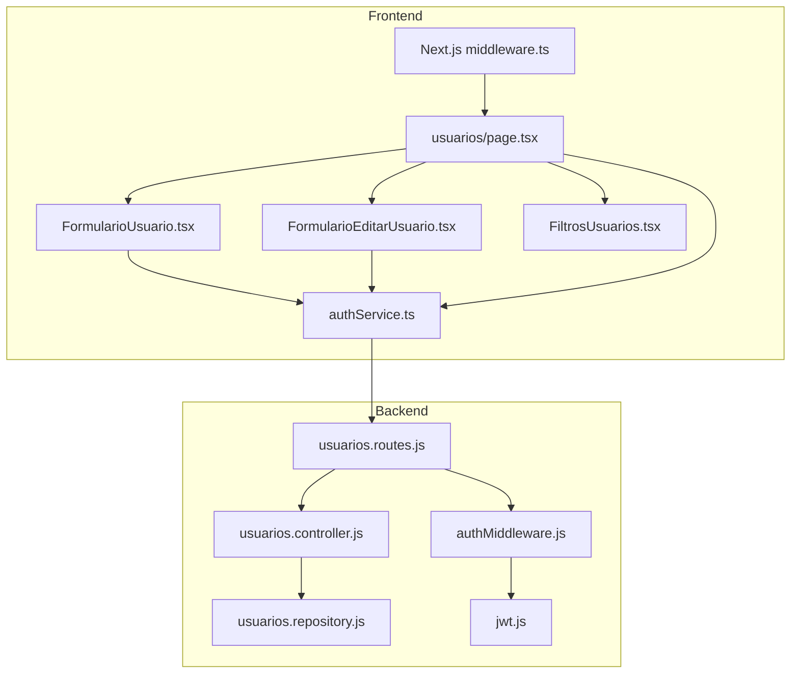
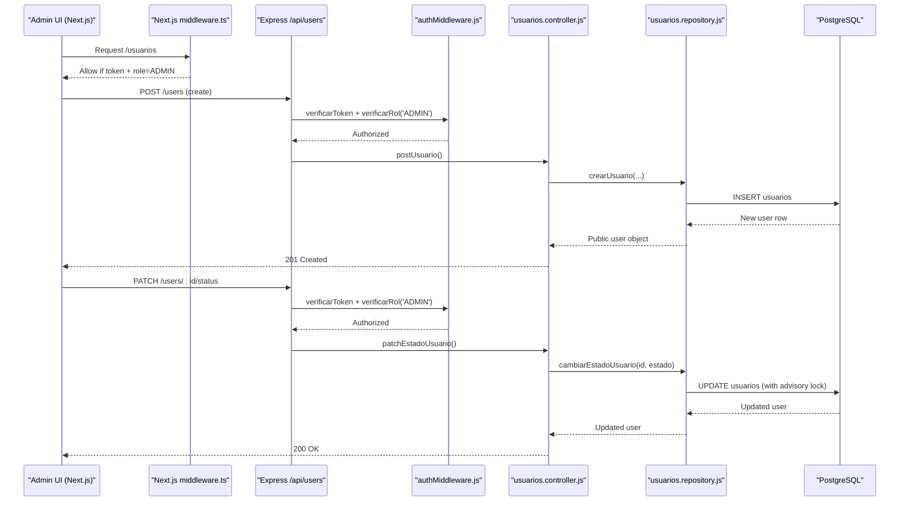
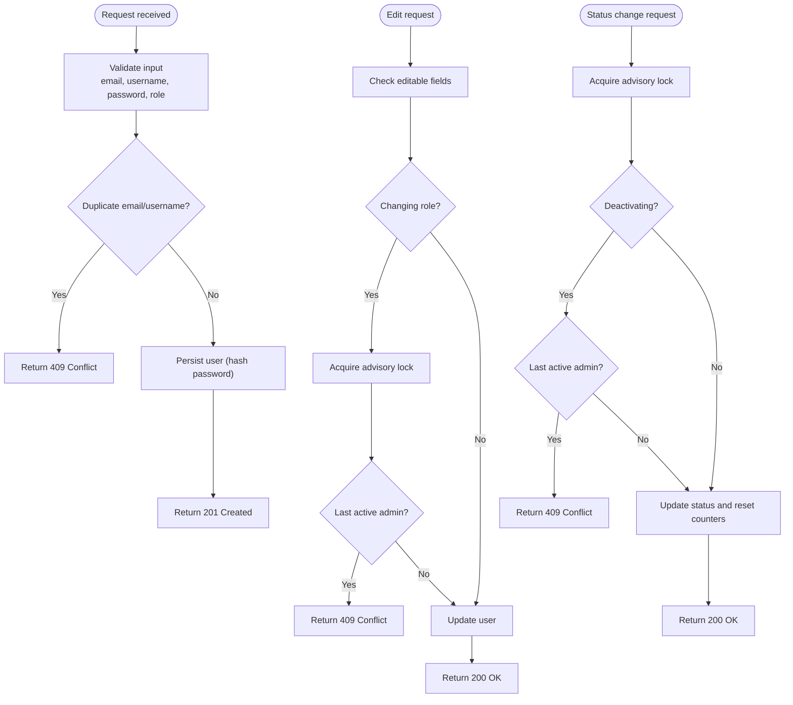
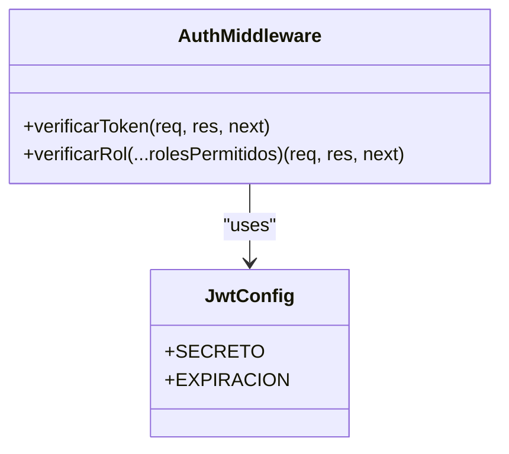
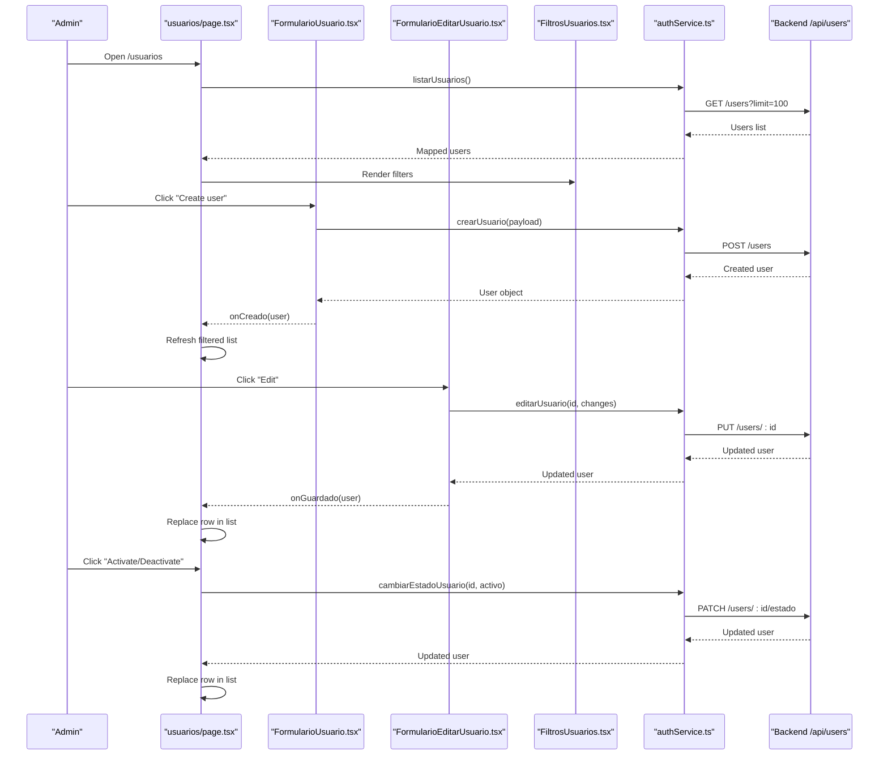
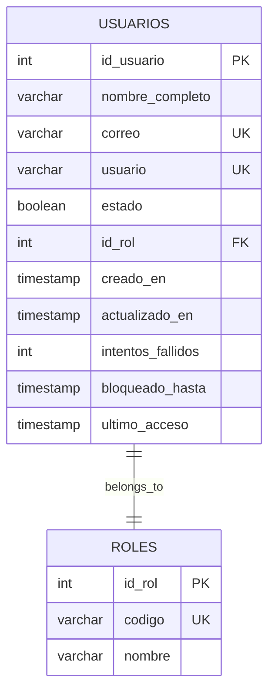
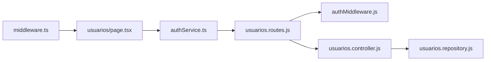

# User Management Module

<cite>
**Referenced Files in This Document**
- [usuarios.controller.js](file://backend/src/controllers/usuarios.controller.js)
- [usuarios.repository.js](file://backend/src/repositories/usuarios.repository.js)
- [usuarios.routes.js](file://backend/src/routes/usuarios.routes.js)
- [authMiddleware.js](file://backend/middleware/authMiddleware.js)
- [jwt.js](file://backend/src/config/jwt.js)
- [page.tsx](file://simoapp/app/(protected)/usuarios/page.tsx)
- [FormularioUsuario.tsx](file://simoapp/components/usuarios/FormularioUsuario.tsx)
- [FormularioEditarUsuario.tsx](file://simoapp/components/usuarios/FormularioEditarUsuario.tsx)
- [FiltrosUsuarios.tsx](file://simoapp/components/usuarios/FiltrosUsuarios.tsx)
- [authService.ts](file://simoapp/lib/auth/authService.ts)
- [validaciones.ts](file://simoapp/lib/auth/validaciones.ts)
- [middleware.ts](file://simoapp/middleware.ts)
</cite>

## Table of Contents
1. [Introduction](#introduction)
2. [Project Structure](#project-structure)
3. [Core Components](#core-components)
4. [Architecture Overview](#architecture-overview)
5. [Detailed Component Analysis](#detailed-component-analysis)
6. [Dependency Analysis](#dependency-analysis)
7. [Performance Considerations](#performance-considerations)
8. [Troubleshooting Guide](#troubleshooting-guide)
9. [Conclusion](#conclusion)

## Introduction
This document explains the user management module that allows administrators to create, edit, list, and manage users, assign roles, and control account status. It covers both backend APIs and the Next.js admin interface, including authentication, role-based access control (RBAC), validation rules, and operational safeguards such as preventing removal of the last active administrator.

The module provides:
- Admin-only endpoints for user CRUD operations.
- Role assignment with built-in protection against leaving the system without active administrators.
- Status management (activate/deactivate) with immediate session enforcement.
- A frontend admin page with filtering, inline editing, and confirmation flows.
- Validation rules for emails, usernames, and passwords aligned between frontend and backend.

## Project Structure
The user management feature spans backend controllers, repositories, routes, middleware, and a Next.js admin UI. The key files are:

- Backend API layer:
  - Routes define protected endpoints under `/api/users`.
  - Controller validates input, enforces business rules, and delegates persistence.
  - Repository handles database queries, transactions, and concurrency safeguards.
  - Middleware authenticates requests and enforces RBAC.
  - JWT configuration centralizes secret and expiration settings.

- Frontend admin UI:
  - Protected route `/usuarios` is guarded by Next.js middleware.
  - Page orchestrates listing, filters, creation, editing, and status changes.
  - Forms validate inputs locally and call shared service functions.
  - Service layer maps frontend types to backend payloads and errors.

**Diagram sources**
- [middleware.ts:1-37](file://simoapp/middleware.ts#L1-L37)
- [page.tsx:1-416](file://simoapp/app/(protected)/usuarios/page.tsx#L1-L416)
- [FormularioUsuario.tsx:1-177](file://simoapp/components/usuarios/FormularioUsuario.tsx#L1-L177)
- [FormularioEditarUsuario.tsx:1-174](file://simoapp/components/usuarios/FormularioEditarUsuario.tsx#L1-L174)
- [FiltrosUsuarios.tsx:1-110](file://simoapp/components/usuarios/FiltrosUsuarios.tsx#L1-L110)
- [authService.ts:1-252](file://simoapp/lib/auth/authService.ts#L1-L252)
- [usuarios.routes.js:1-18](file://backend/src/routes/usuarios.routes.js#L1-L18)
- [usuarios.controller.js:1-295](file://backend/src/controllers/usuarios.controller.js#L1-L295)
- [usuarios.repository.js:1-242](file://backend/src/repositories/usuarios.repository.js#L1-L242)
- [authMiddleware.js:1-81](file://backend/middleware/authMiddleware.js#L1-L81)
- [jwt.js:1-16](file://backend/src/config/jwt.js#L1-L16)

**Section sources**
- [middleware.ts:1-37](file://simoapp/middleware.ts#L1-L37)
- [usuarios.routes.js:1-18](file://backend/src/routes/usuarios.routes.js#L1-L18)
- [usuarios.controller.js:1-295](file://backend/src/controllers/usuarios.controller.js#L1-L295)
- [usuarios.repository.js:1-242](file://backend/src/repositories/usuarios.repository.js#L1-L242)
- [authMiddleware.js:1-81](file://backend/middleware/authMiddleware.js#L1-L81)
- [jwt.js:1-16](file://backend/src/config/jwt.js#L1-L16)
- [page.tsx:1-416](file://simoapp/app/(protected)/usuarios/page.tsx#L1-L416)
- [FormularioUsuario.tsx:1-177](file://simoapp/components/usuarios/FormularioUsuario.tsx#L1-L177)
- [FormularioEditarUsuario.tsx:1-174](file://simoapp/components/usuarios/FormularioEditarUsuario.tsx#L1-L174)
- [FiltrosUsuarios.tsx:1-110](file://simoapp/components/usuarios/FiltrosUsuarios.tsx#L1-L110)
- [authService.ts:1-252](file://simoapp/lib/auth/authService.ts#L1-L252)
- [validaciones.ts:1-126](file://simoapp/lib/auth/validaciones.ts#L1-L126)

## Core Components
- Admin-only routes:
  - POST `/api/users`: Create user.
  - GET `/api/users`: List users with pagination and filters.
  - GET `/api/users/:id`: Get user details.
  - PUT `/api/users/:id`: Edit user fields (name, email, username, role).
  - PATCH `/api/users/:id/status` or `/api/users/:id/estado`: Activate/deactivate user.

- Authentication and RBAC:
  - `verificarToken` validates JWT, checks blacklist, and enforces active status.
  - `verificarRol` restricts endpoints to allowed roles.

- Business rules:
  - Password minimum length enforced on create.
  - Email format validated.
  - Duplicate email/username prevented.
  - Last active administrator cannot be deactivated or stripped of admin role.

- Frontend admin page:
  - Lists users, supports role and status filters.
  - Creates users via modal form.
  - Edits users via modal form.
  - Confirms activation/deactivation via modal.

**Section sources**
- [usuarios.routes.js:1-18](file://backend/src/routes/usuarios.routes.js#L1-L18)
- [usuarios.controller.js:1-295](file://backend/src/controllers/usuarios.controller.js#L1-L295)
- [authMiddleware.js:1-81](file://backend/middleware/authMiddleware.js#L1-L81)
- [page.tsx:1-416](file://simoapp/app/(protected)/usuarios/page.tsx#L1-L416)

## Architecture Overview
The user management flow combines Next.js client-side components with Express routes and PostgreSQL persistence. Requests are authenticated and authorized before reaching controllers, which validate inputs and delegate to repositories for safe data operations.

**Diagram sources**
- [middleware.ts:1-37](file://simoapp/middleware.ts#L1-L37)
- [usuarios.routes.js:1-18](file://backend/src/routes/usuarios.routes.js#L1-L18)
- [usuarios.controller.js:1-295](file://backend/src/controllers/usuarios.controller.js#L1-L295)
- [usuarios.repository.js:1-242](file://backend/src/repositories/usuarios.repository.js#L1-L242)
- [authMiddleware.js:1-81](file://backend/middleware/authMiddleware.js#L1-L81)

## Detailed Component Analysis

### Backend API Layer
- Routes:
  - Protect all endpoints with JWT verification and role checks.
  - Support both `/status` and `/estado` aliases for status change.

- Controller:
  - Validates required fields, email format, password length, and role existence.
  - Prevents duplicates and returns clear error messages.
  - Enforces business rules:
    - Do not allow removing admin role from the last active admin.
    - Do not allow deactivating the last active admin.
  - Returns standardized responses and HTTP status codes.

- Repository:
  - Uses transactions and advisory locks to prevent race conditions when changing roles or status.
  - Locks concurrent updates to ensure at least one active admin remains.
  - Exposes public columns only; never exposes password hashes.

**Diagram sources**
- [usuarios.controller.js:29-84](file://backend/src/controllers/usuarios.controller.js#L29-L84)
- [usuarios.controller.js:172-255](file://backend/src/controllers/usuarios.controller.js#L172-L255)
- [usuarios.controller.js:263-292](file://backend/src/controllers/usuarios.controller.js#L263-L292)
- [usuarios.repository.js:115-172](file://backend/src/repositories/usuarios.repository.js#L115-L172)
- [usuarios.repository.js:178-230](file://backend/src/repositories/usuarios.repository.js#L178-L230)

**Section sources**
- [usuarios.routes.js:1-18](file://backend/src/routes/usuarios.routes.js#L1-L18)
- [usuarios.controller.js:1-295](file://backend/src/controllers/usuarios.controller.js#L1-L295)
- [usuarios.repository.js:1-242](file://backend/src/repositories/usuarios.repository.js#L1-L242)

### Authentication and RBAC
- Token verification:
  - Checks Authorization header, decodes JWT, verifies signature.
  - Rejects blacklisted tokens and inactive accounts immediately.
  - Attaches decoded user info to request context.

- Role-based authorization:
  - Allows numeric role IDs or role codes.
  - Denies unauthorized access with clear error messages.

- JWT configuration:
  - Centralized secret and expiration.
  - Warns if production secret is missing.

**Diagram sources**
- [authMiddleware.js:1-81](file://backend/middleware/authMiddleware.js#L1-L81)
- [jwt.js:1-16](file://backend/src/config/jwt.js#L1-L16)

**Section sources**
- [authMiddleware.js:1-81](file://backend/middleware/authMiddleware.js#L1-L81)
- [jwt.js:1-16](file://backend/src/config/jwt.js#L1-L16)

### Frontend Admin Interface
- Protected route:
  - Next.js middleware redirects non-admin users away from `/usuarios`.

- Users page:
  - Loads user list, shows skeletons while loading, and displays retry option on error.
  - Provides filters for role and status.
  - Renders actions per row: Edit and Activate/Deactivate.
  - Marks current admin user with a badge.

- Create user form:
  - Validates name, email, username, role, and password (minimum length).
  - Sends payload mapping frontend role codes to backend role IDs.
  - Displays general error messages from backend.

- Edit user form:
  - Pre-fills with existing user data.
  - Disables role change for the current admin user.
  - Prevents submission if no changes were made.

- Filters:
  - Combines role and status filters.
  - Shows counts and a “Clear filters” button.

**Diagram sources**
- [page.tsx:1-416](file://simoapp/app/(protected)/usuarios/page.tsx#L1-L416)
- [FormularioUsuario.tsx:1-177](file://simoapp/components/usuarios/FormularioUsuario.tsx#L1-L177)
- [FormularioEditarUsuario.tsx:1-174](file://simoapp/components/usuarios/FormularioEditarUsuario.tsx#L1-L174)
- [FiltrosUsuarios.tsx:1-110](file://simoapp/components/usuarios/FiltrosUsuarios.tsx#L1-L110)
- [authService.ts:1-252](file://simoapp/lib/auth/authService.ts#L1-L252)

**Section sources**
- [middleware.ts:1-37](file://simoapp/middleware.ts#L1-L37)
- [page.tsx:1-416](file://simoapp/app/(protected)/usuarios/page.tsx#L1-L416)
- [FormularioUsuario.tsx:1-177](file://simoapp/components/usuarios/FormularioUsuario.tsx#L1-L177)
- [FormularioEditarUsuario.tsx:1-174](file://simoapp/components/usuarios/FormularioEditarUsuario.tsx#L1-L174)
- [FiltrosUsuarios.tsx:1-110](file://simoapp/components/usuarios/FiltrosUsuarios.tsx#L1-L110)
- [authService.ts:1-252](file://simoapp/lib/auth/authService.ts#L1-L252)

### Data Models and Relationships
- User entity includes identifiers, full name, email, username, status, role association, timestamps, and security-related fields.
- Role entity defines role code and name.
- Relationship: Many users belong to one role.

**Diagram sources**
- [usuarios.repository.js:6-10](file://backend/src/repositories/usuarios.repository.js#L6-L10)

**Section sources**
- [usuarios.repository.js:1-242](file://backend/src/repositories/usuarios.repository.js#L1-L242)

### Validation Rules and Policies
- Password policy:
  - Minimum length enforced on create (frontend and backend align).
- Email policy:
  - Valid email format required.
- Username policy:
  - No spaces allowed.
- Role policy:
  - Must exist in the roles table.
  - Cannot remove admin role from the last active admin.
- Account lockout mechanisms:
  - Fields for failed attempts and block until time exist in the user model.
  - Reactivating a user clears failed attempts and block expiry.

**Section sources**
- [validaciones.ts:16-45](file://simoapp/lib/auth/validaciones.ts#L16-L45)
- [usuarios.controller.js:44-53](file://backend/src/controllers/usuarios.controller.js#L44-L53)
- [usuarios.repository.js:209-217](file://backend/src/repositories/usuarios.repository.js#L209-L217)

## Dependency Analysis
- Frontend dependencies:
  - Next.js middleware guards `/usuarios` based on cookie role.
  - Page component composes forms and filters.
  - Service layer abstracts API calls and error mapping.

- Backend dependencies:
  - Routes depend on auth middleware for JWT and RBAC.
  - Controllers depend on repositories for data operations.
  - Repositories depend on database pool and use advisory locks for safety.

**Diagram sources**
- [middleware.ts:1-37](file://simoapp/middleware.ts#L1-L37)
- [page.tsx:1-416](file://simoapp/app/(protected)/usuarios/page.tsx#L1-L416)
- [authService.ts:1-252](file://simoapp/lib/auth/authService.ts#L1-L252)
- [usuarios.routes.js:1-18](file://backend/src/routes/usuarios.routes.js#L1-L18)
- [authMiddleware.js:1-81](file://backend/middleware/authMiddleware.js#L1-L81)
- [usuarios.controller.js:1-295](file://backend/src/controllers/usuarios.controller.js#L1-L295)
- [usuarios.repository.js:1-242](file://backend/src/repositories/usuarios.repository.js#L1-L242)

**Section sources**
- [middleware.ts:1-37](file://simoapp/middleware.ts#L1-L37)
- [usuarios.routes.js:1-18](file://backend/src/routes/usuarios.routes.js#L1-L18)
- [authMiddleware.js:1-81](file://backend/middleware/authMiddleware.js#L1-L81)

## Performance Considerations
- Pagination:
  - Listing users uses server-side pagination with configurable limit and page parameters.
  - Frontend currently fetches up to 100 users and may need additional pages if the dataset grows.

- Query efficiency:
  - Repository builds dynamic WHERE clauses and uses indexed joins where appropriate.
  - Advisory locks serialize critical sections to avoid race conditions.

- Client-side rendering:
  - Skeleton loaders improve perceived performance during data fetching.
  - Local filtering reduces unnecessary re-renders.

[No sources needed since this section provides general guidance]

## Troubleshooting Guide
Common administrative tasks and issues:
- Creating a user fails due to duplicate email/username:
  - Ensure uniqueness constraints are satisfied; the backend returns conflict errors.
- Editing a user fails because another user already has the same email/username:
  - Change the conflicting field to a unique value.
- Cannot deactivate the last active administrator:
  - System prevents leaving zero active admins; add another admin first.
- Cannot remove admin role from the last active administrator:
  - Assign admin role to another active user before changing the last admin’s role.
- Inactive users cannot authenticate:
  - Reactivate the user via the status endpoint; the middleware rejects inactive accounts immediately.
- Session blocked after multiple failed login attempts:
  - Reactivate the user to clear failed attempt counters and block expiry.

Operational tips:
- Use filters to quickly locate users by role and status.
- Confirm activation/deactivation through the confirmation modal to avoid accidental changes.
- Monitor error messages returned by the service layer for precise diagnostics.

**Section sources**
- [usuarios.controller.js:55-83](file://backend/src/controllers/usuarios.controller.js#L55-L83)
- [usuarios.controller.js:223-255](file://backend/src/controllers/usuarios.controller.js#L223-L255)
- [usuarios.controller.js:274-292](file://backend/src/controllers/usuarios.controller.js#L274-L292)
- [usuarios.repository.js:140-153](file://backend/src/repositories/usuarios.repository.js#L140-L153)
- [usuarios.repository.js:197-207](file://backend/src/repositories/usuarios.repository.js#L197-L207)
- [authMiddleware.js:30-45](file://backend/middleware/authMiddleware.js#L30-L45)

## Conclusion
The user management module provides a secure, robust, and user-friendly way to administer users within the application. It enforces strong validation, protects critical state transitions with transactional safeguards, and integrates tightly with authentication and RBAC. Administrators can confidently create, edit, and manage users while ensuring system integrity and security.

[No sources needed since this section summarizes without analyzing specific files]