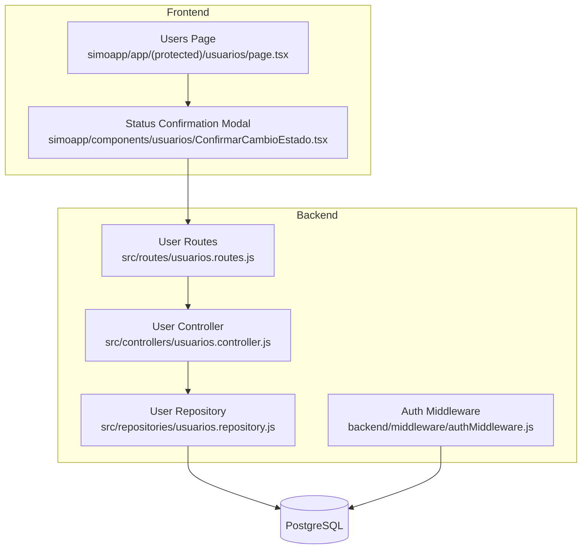
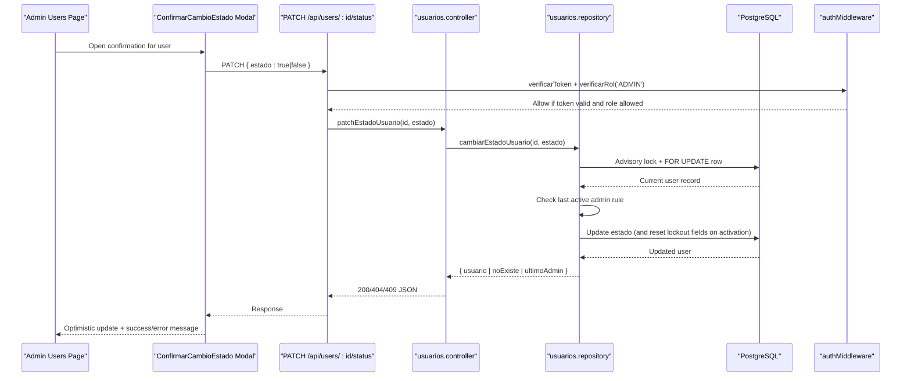
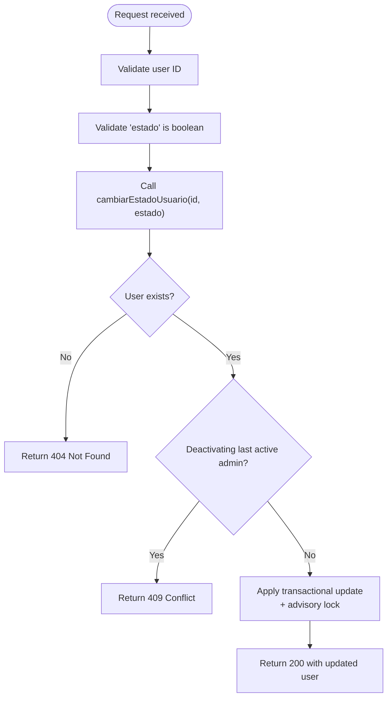
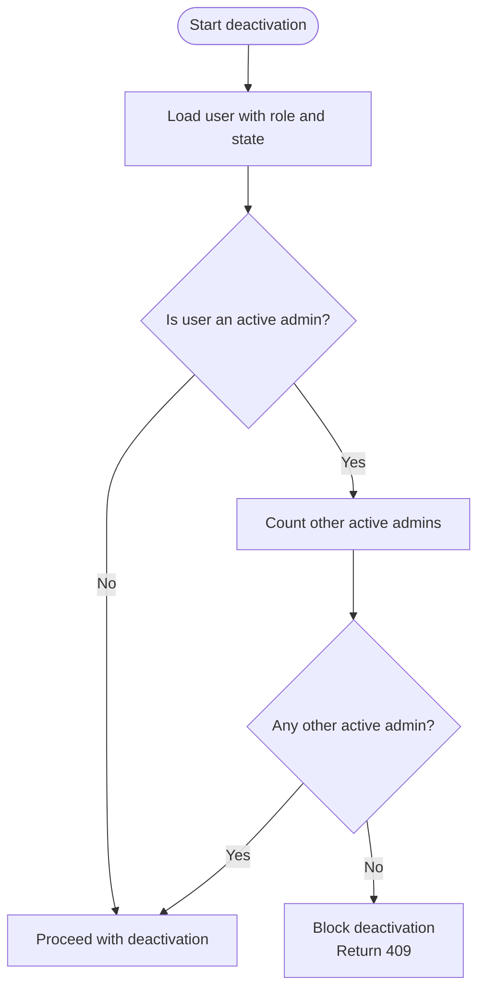
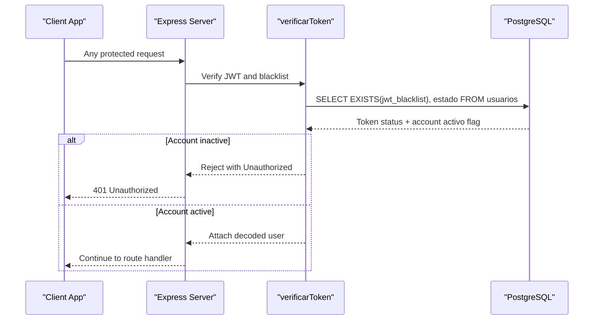
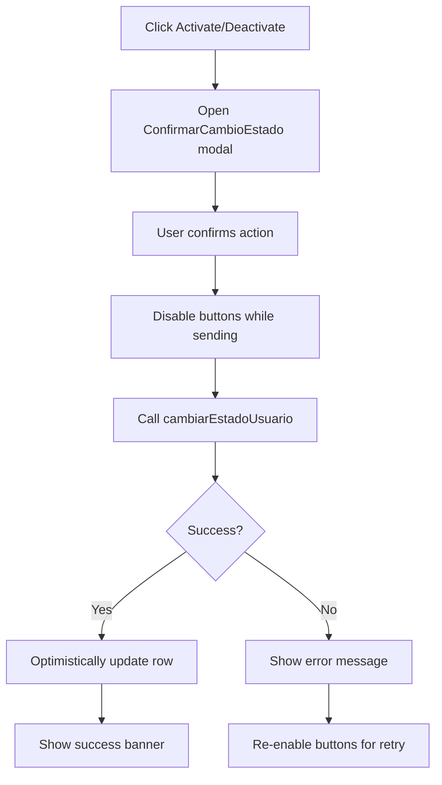
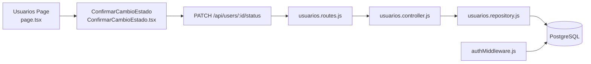

# User Status Management

<cite>
**Referenced Files in This Document**
- [usuarios.routes.js](file://backend/src/routes/usuarios.routes.js)
- [usuarios.controller.js](file://backend/src/controllers/usuarios.controller.js)
- [usuarios.repository.js](file://backend/src/repositories/usuarios.repository.js)
- [authMiddleware.js](file://backend/middleware/authMiddleware.js)
- [ConfirmarCambioEstado.tsx](file://simoapp/components/usuarios/ConfirmarCambioEstado.tsx)
- [usuarios page.tsx](file://simoapp/app/(protected)/usuarios/page.tsx)
- [usuarios.test.js](file://backend/tests/integracion/usuarios.test.js)
</cite>

## Table of Contents
1. [Introduction](#introduction)
2. [Project Structure](#project-structure)
3. [Core Components](#core-components)
4. [Architecture Overview](#architecture-overview)
5. [Detailed Component Analysis](#detailed-component-analysis)
6. [Dependency Analysis](#dependency-analysis)
7. [Performance Considerations](#performance-considerations)
8. [Troubleshooting Guide](#troubleshooting-guide)
9. [Conclusion](#conclusion)

## Introduction
This document explains the user status management functionality that allows administrators to activate or deactivate user accounts through the PATCH `/api/users/:id/status` endpoint. It covers the backend API, business rules (including protection against deactivating the last active administrator), frontend confirmation dialog, immediate session termination for deactivated users, and integration with authentication. It also provides guidance for administrative workflows such as bulk activation/deactivation and troubleshooting access issues related to user status.

## Project Structure
The user status feature spans both backend and frontend:

- Backend routes expose two equivalent endpoints: `/status` and `/estado`.
- The controller validates input and delegates state changes to the repository.
- The repository performs transactional updates with advisory locks to prevent race conditions when changing roles or status.
- Authentication middleware enforces account status on every request, immediately invalidating access for deactivated users.
- Frontend shows a confirmation modal before changing status and updates the table optimistically.

**Diagram sources**
- [usuarios.routes.js:9-15](file://backend/src/routes/usuarios.routes.js#L9-L15)
- [usuarios.controller.js:257-291](file://backend/src/controllers/usuarios.controller.js#L257-L291)
- [usuarios.repository.js:174-230](file://backend/src/repositories/usuarios.repository.js#L174-L230)
- [authMiddleware.js:9-49](file://backend/middleware/authMiddleware.js#L9-L49)
- [usuarios page.tsx:378-412](file://simoapp/app/(protected)/usuarios/page.tsx#L378-L412)
- [ConfirmarCambioEstado.tsx:25-44](file://simoapp/components/usuarios/ConfirmarCambioEstado.tsx#L25-L44)

**Section sources**
- [usuarios.routes.js:1-17](file://backend/src/routes/usuarios.routes.js#L1-L17)
- [usuarios.controller.js:1-295](file://backend/src/controllers/usuarios.controller.js#L1-L295)
- [usuarios.repository.js:1-242](file://backend/src/repositories/usuarios.repository.js#L1-L242)
- [authMiddleware.js:1-81](file://backend/middleware/authMiddleware.js#L1-L81)
- [ConfirmarCambioEstado.tsx:1-96](file://simoapp/components/usuarios/ConfirmarCambioEstado.tsx#L1-L96)
- [usuarios page.tsx:1-416](file://simoapp/app/(protected)/usuarios/page.tsx#L1-L416)

## Core Components
- **PATCH /api/users/:id/status**: Activates or deactivates a user by setting their `estado` field. It requires an authenticated admin token and returns the updated user object.
- **Business rule protection**: Deactivating the last active administrator is blocked to preserve system administration capability.
- **Authentication enforcement**: Every request checks whether the current user’s account is active; if not, the request is rejected even if the JWT is still valid.
- **Frontend confirmation**: A modal asks for explicit confirmation before activating or deactivating a user, preventing accidental changes.

Key responsibilities:
- Route layer: authorization via JWT and role check.
- Controller layer: input validation and response formatting.
- Repository layer: transactional update with advisory lock and last-admin protection.
- Auth middleware: real-time account status enforcement.
- Frontend: confirmation UI and optimistic list update.

**Section sources**
- [usuarios.routes.js:9-15](file://backend/src/routes/usuarios.routes.js#L9-L15)
- [usuarios.controller.js:257-291](file://backend/src/controllers/usuarios.controller.js#L257-L291)
- [usuarios.repository.js:174-230](file://backend/src/repositories/usuarios.repository.js#L174-L230)
- [authMiddleware.js:29-49](file://backend/middleware/authMiddleware.js#L29-L49)
- [ConfirmarCambioEstado.tsx:25-44](file://simoapp/components/usuarios/ConfirmarCambioEstado.tsx#L25-L44)

## Architecture Overview
The status change flow involves coordinated layers:

**Diagram sources**
- [usuarios.routes.js:14-15](file://backend/src/routes/usuarios.routes.js#L14-L15)
- [usuarios.controller.js:263-291](file://backend/src/controllers/usuarios.controller.js#L263-L291)
- [usuarios.repository.js:178-223](file://backend/src/repositories/usuarios.repository.js#L178-L223)
- [authMiddleware.js:9-49](file://backend/middleware/authMiddleware.js#L9-L49)
- [ConfirmarCambioEstado.tsx:34-44](file://simoapp/components/usuarios/ConfirmarCambioEstado.tsx#L34-L44)
- [usuarios page.tsx:378-412](file://simoapp/app/(protected)/usuarios/page.tsx#L378-L412)

## Detailed Component Analysis

### Backend API: PATCH /api/users/:id/status
- **Route registration**: Two paths are supported: `/status` and `/estado`, both requiring authentication and admin role.
- **Controller logic**: Validates user ID and boolean `estado`, calls repository, and maps results to HTTP responses:
  - 200 with updated user on success.
  - 404 if user does not exist.
  - 409 if attempting to deactivate the last active administrator.
  - 400 for invalid input.
- **Repository logic**: Uses a transaction with an advisory lock to serialize concurrent role/status changes, then:
  - Locks the target row (`FOR UPDATE`).
  - Prevents deactivating the last active administrator.
  - Updates `estado`; on activation, clears failed login attempts and block expiry.
  - Returns structured result for the controller to interpret.

**Diagram sources**
- [usuarios.controller.js:263-291](file://backend/src/controllers/usuarios.controller.js#L263-L291)
- [usuarios.repository.js:178-223](file://backend/src/repositories/usuarios.repository.js#L178-L223)

**Section sources**
- [usuarios.routes.js:14-15](file://backend/src/routes/usuarios.routes.js#L14-L15)
- [usuarios.controller.js:257-291](file://backend/src/controllers/usuarios.controller.js#L257-L291)
- [usuarios.repository.js:174-230](file://backend/src/repositories/usuarios.repository.js#L174-L230)

### Business Logic: Last Active Administrator Protection
- The repository prevents deactivating the only active administrator to ensure at least one admin remains available.
- This rule applies both to status changes and role changes, using the same advisory lock key to serialize operations.
- If attempted, the controller responds with a conflict error indicating the operation is disallowed.

**Diagram sources**
- [usuarios.repository.js:197-207](file://backend/src/repositories/usuarios.repository.js#L197-L207)
- [usuarios.controller.js:278-283](file://backend/src/controllers/usuarios.controller.js#L278-L283)

**Section sources**
- [usuarios.repository.js:174-230](file://backend/src/repositories/usuarios.repository.js#L174-L230)
- [usuarios.controller.js:257-291](file://backend/src/controllers/usuarios.controller.js#L257-L291)

### Authentication Integration: Immediate Session Effect
- On every request, the auth middleware verifies the JWT and checks the user’s current account status.
- If the account is inactive, the request is rejected with an unauthorized response, even if the token has not expired.
- This ensures that deactivating a user takes effect immediately across all open sessions.

**Diagram sources**
- [authMiddleware.js:9-49](file://backend/middleware/authMiddleware.js#L9-L49)

**Section sources**
- [authMiddleware.js:9-49](file://backend/middleware/authMiddleware.js#L9-L49)

### Frontend Confirmation Dialog
- The Users page opens a confirmation modal before changing a user’s status.
- The modal displays clear messaging about what will happen (login disabled for deactivation, re-enabled for activation).
- While waiting for the server response, buttons are disabled to prevent duplicate requests.
- On success, the Users page updates the affected row optimistically without reloading the entire list.

**Diagram sources**
- [ConfirmarCambioEstado.tsx:34-44](file://simoapp/components/usuarios/ConfirmarCambioEstado.tsx#L34-L44)
- [usuarios page.tsx:378-412](file://simoapp/app/(protected)/usuarios/page.tsx#L378-L412)

**Section sources**
- [ConfirmarCambioEstado.tsx:1-96](file://simoapp/components/usuarios/ConfirmarCambioEstado.tsx#L1-L96)
- [usuarios page.tsx:378-412](file://simoapp/app/(protected)/usuarios/page.tsx#L378-L412)

### Error Handling Contract
- Invalid user ID or non-boolean `estado` returns 400 Bad Request.
- Non-existent user returns 404 Not Found.
- Attempting to deactivate the last active administrator returns 409 Conflict.
- Internal errors return 500 with a generic message.

These behaviors are validated by integration tests covering parameter validation, existence checks, last-admin protection, and immediate session termination upon deactivation.

**Section sources**
- [usuarios.controller.js:263-291](file://backend/src/controllers/usuarios.controller.js#L263-L291)
- [usuarios.test.js:280-329](file://backend/tests/integracion/usuarios.test.js#L280-L329)

## Dependency Analysis
The following diagram shows how components depend on each other for user status management:

**Diagram sources**
- [usuarios page.tsx:378-412](file://simoapp/app/(protected)/usuarios/page.tsx#L378-L412)
- [ConfirmarCambioEstado.tsx:25-44](file://simoapp/components/usuarios/ConfirmarCambioEstado.tsx#L25-L44)
- [usuarios.routes.js:14-15](file://backend/src/routes/usuarios.routes.js#L14-L15)
- [usuarios.controller.js:263-291](file://backend/src/controllers/usuarios.controller.js#L263-L291)
- [usuarios.repository.js:178-223](file://backend/src/repositories/usuarios.repository.js#L178-L223)
- [authMiddleware.js:29-49](file://backend/middleware/authMiddleware.js#L29-L49)

**Section sources**
- [usuarios.routes.js:1-17](file://backend/src/routes/usuarios.routes.js#L1-L17)
- [usuarios.controller.js:1-295](file://backend/src/controllers/usuarios.controller.js#L1-L295)
- [usuarios.repository.js:1-242](file://backend/src/repositories/usuarios.repository.js#L1-L242)
- [authMiddleware.js:1-81](file://backend/middleware/authMiddleware.js#L1-L81)
- [ConfirmarCambioEstado.tsx:1-96](file://simoapp/components/usuarios/ConfirmarCambioEstado.tsx#L1-L96)
- [usuarios page.tsx:1-416](file://simoapp/app/(protected)/usuarios/page.tsx#L1-L416)

## Performance Considerations
- **Advisory locking**: The repository uses an advisory transaction lock to serialize concurrent role/status changes, avoiding race conditions that could leave the system without an active administrator.
- **Row-level locking**: `FOR UPDATE OF u` ensures consistent reads during updates.
- **Minimal payload**: The PATCH endpoint accepts only the necessary `estado` boolean, reducing network overhead.
- **Optimistic UI updates**: The frontend updates the affected row immediately after success, improving perceived performance.

Recommendations:
- Keep advisory lock keys stable to avoid contention spikes.
- Monitor database locks and slow queries around status/role changes.
- Avoid unnecessary full-list reloads; rely on optimistic updates where possible.

[No sources needed since this section provides general guidance]

## Troubleshooting Guide
Common scenarios and resolutions:

- **Cannot deactivate a user because they are the last active administrator**:
  - Cause: System protects against leaving zero active admins.
  - Resolution: First assign another user to the admin role and activate them, then deactivate the previous admin.

- **Deactivated user cannot log in or access resources**:
  - Cause: Auth middleware rejects requests from inactive accounts immediately.
  - Resolution: Reactivate the user via the PATCH endpoint or the admin UI.

- **Invalid request body or user ID**:
  - Cause: Missing or incorrect `estado` value, or non-positive integer ID.
  - Resolution: Ensure `estado` is a boolean and the ID is a positive integer.

- **Concurrent edits causing conflicts**:
  - Cause: Simultaneous role/status changes can conflict due to last-admin protection.
  - Resolution: Retry after the first operation completes; the advisory lock serializes these operations.

- **Frontend shows error after confirming status change**:
  - Cause: Server returned 400/404/409.
  - Resolution: Inspect the error message and correct the operation (e.g., try a different target user or restore admin coverage).

**Section sources**
- [usuarios.controller.js:263-291](file://backend/src/controllers/usuarios.controller.js#L263-L291)
- [usuarios.repository.js:178-223](file://backend/src/repositories/usuarios.repository.js#L178-L223)
- [authMiddleware.js:29-49](file://backend/middleware/authMiddleware.js#L29-L49)
- [usuarios.test.js:280-329](file://backend/tests/integracion/usuarios.test.js#L280-L329)

## Conclusion
The user status management feature provides a secure, auditable way for administrators to activate or deactivate user accounts. The backend enforces critical business rules, including protecting the last active administrator, while the authentication middleware ensures immediate effect on sessions. The frontend offers a clear confirmation workflow and responsive UI updates. Together, these components deliver a robust solution for managing user access and maintaining system integrity.

[No sources needed since this section summarizes without analyzing specific files]