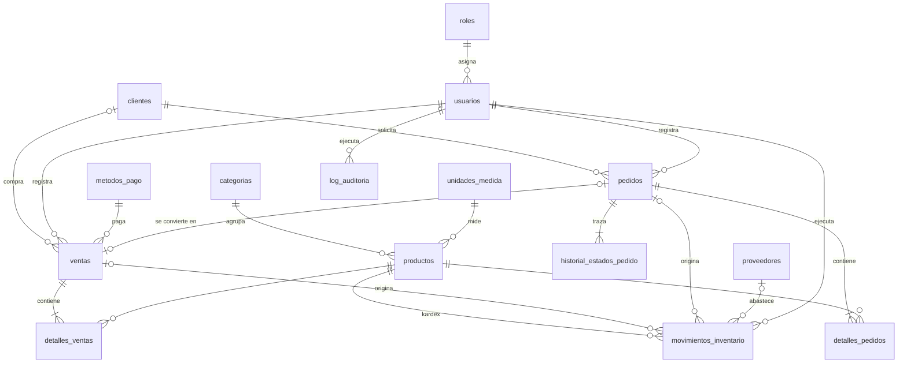

# Base de datos SIMO (SCRUM-84)

Esquema relacional consolidado en PostgreSQL (desarrollado para 18, probado en 16). Reemplaza los scripts sueltos de `backend/scripts/` e incorpora el inventario dual Bodega/Almacén.

```
db/
├── 00_init.sh              # ejecuta migraciones + seeds (lo usa Docker)
├── migrations/             # esquema, en orden; se pueden re-ejecutar sin error
│   ├── 001_base.sql            funciones compartidas, zona horaria
│   ├── 002_seguridad.sql       roles, usuarios, empresa
│   ├── 003_catalogo.sql        unidades_medida, categorias, productos
│   ├── 004_clientes_pedidos.sql clientes, pedidos, detalles, historial de estados
│   ├── 005_ventas.sql          metodos_pago, ventas, detalles_ventas
│   ├── 006_inventario.sql      proveedores, movimientos_inventario, vista v_kardex
│   ├── 007_auditoria.sql       log_auditoria
│   ├── 008_ingreso_bodega.sql  función fn_registrar_ingreso_bodega (HU-05)
│   ├── 009_clientes.sql        búsqueda por documento y documento inalterable (HU-09)
│   ├── 010_sesiones.sql        tokens invalidados por cierre de sesión (SCRUM-17)
│   ├── 011_compras.sql         compras a proveedor y sp_confirmar_compra (SCRUM-45)
│   ├── 012_saldo_kardex.sql    fn_kardex_producto y fn_validar_kardex (SCRUM-132)
│   ├── 013_indices_ventas.sql  índices B-tree de cobertura para ventas (SCRUM-133)
│   ├── 014_ajustes_inventario.sql fn_registrar_ajuste y orden del Kardex con concurrencia (SCRUM-42)
│   ├── 015_pedidos.sql         total y reglas de las líneas de pedido (SCRUM-81)
│   └── 016_estados_pedido.sql  fn_cambiar_estado_pedido: stock al preparar y al cancelar (SCRUM-61)
├── seeds/
│   └── 001_datos_desarrollo.sql  usuarios de prueba, empresa, categorías, productos
├── carga/
│   ├── poblar_masivo.sql         datos masivos coherentes para pruebas de carga (SCRUM-131)
│   └── consultas_rendimiento.sql consultas de referencia con EXPLAIN ANALYZE (SCRUM-133)
└── tests/
    ├── 001_reglas_esquema.sql    42 pruebas de reglas de negocio (no deja datos)
    ├── 002_ingreso_bodega.sql    19 pruebas del ingreso a Bodega (no deja datos)
    ├── 003_compras.sql           17 pruebas de compras y sp_confirmar_compra (no deja datos)
    ├── 004_saldo_kardex.sql      12 pruebas del saldo y la valorización del Kardex (no deja datos)
    ├── 005_ajustes.sql           20 pruebas de ajustes manuales y su auditoría (no deja datos)
    ├── 006_pedidos.sql           12 pruebas de las líneas y el total de los pedidos (no deja datos)
    └── 007_estados_pedido.sql    17 pruebas del ciclo de estados con descuento y reverso de stock (no deja datos)
```

## Cómo crear la base

**Con Docker** (desde `backend/`): la primera vez que se crea el volumen, PostgreSQL ejecuta `00_init.sh` solo.

```bash
docker compose up -d --build
```

Para borrar la base y recrearla con cambios en las migraciones:

```bash
docker compose down -v && docker compose up -d --build
```

**Sin Docker (pgAdmin / psql):** crear la base `simo_retail` y ejecutar en orden los archivos de `migrations/` y luego los de `seeds/`. O bien:

```bash
POSTGRES_USER=postgres POSTGRES_DB=simo_retail sh db/00_init.sh
```

**Pruebas:**

```bash
psql -v ON_ERROR_STOP=1 -U postgres -d simo_retail -f db/tests/001_reglas_esquema.sql
```

Usuarios de prueba (seed): `admin@`, `gerente@`, `inventario@` y `vendedor@simo.local`, contraseña `Simo2026*`.

## Modelo entidad-relación



## Reglas que garantiza la base de datos

| Regla | Cómo |
|---|---|
| Stock nunca negativo (RNF-04) | `CHECK (stock_bodega >= 0)` y `CHECK (stock_almacen >= 0)` en `productos` |
| Compras solo entran a Bodega (CU-05) | `chk_movimiento_ubicaciones` en `movimientos_inventario` |
| Traslado solo Bodega → Almacén (CU-06) | `chk_movimiento_ubicaciones` |
| Ajuste manual con justificación (RF-10) | `chk_movimiento_motivo_ajuste` |
| Kardex inalterable | trigger bloquea UPDATE/DELETE/TRUNCATE en `movimientos_inventario` |
| Flujo secuencial de pedidos (RN-04) | trigger `fn_validar_transicion_pedido` |
| Fecha, hora y usuario de cada estado (RF-18) | trigger llena `historial_estados_pedido` |
| Cancelación con causa (CU-13) | `chk_historial_motivo_cancelacion` |
| Anulación con autorizador y causa (CU-11) | `chk_ventas_anulacion` |
| Un pedido genera como máximo una venta (RF-20) | `UNIQUE (ventas.id_pedido)` |
| Totales coherentes | `chk_ventas_total`, `chk_*_subtotal` |
| Log de auditoría inalterable (RF-24) | triggers + `REVOKE` en `log_auditoria` |
| Documento del cliente inalterable (CU-09 RB-1) | trigger `fn_documento_cliente_inalterable` (SQLSTATE `SM008`) |

## Convenciones para el backend

1. **Usuario responsable.** Antes de modificar `pedidos`, dentro de la misma transacción:
   ```js
   await client.query("SELECT set_config('simo.id_usuario', $1, true)", [String(req.user.id_usuario)]);
   await client.query("SELECT set_config('simo.motivo', $1, true)", [motivo]); // al cancelar
   ```
   Si falta, la base rechaza el cambio.
2. **El stock no se edita a mano.** `stock_bodega` y `stock_almacen` cambian solo junto con una fila en `movimientos_inventario`, en la misma transacción, bloqueando el producto con `SELECT ... FOR UPDATE`. El ingreso a Bodega ya lo hace `fn_registrar_ingreso_bodega` (migración 008); los traslados, ventas y ajustes seguirán el mismo patrón, con errores de negocio identificados por SQLSTATE de clase `SM`.
3. **Deducción en cascada.** Una línea de venta o pedido genera hasta dos movimientos `SALIDA_*` (primero `ALMACEN`, luego `BODEGA`). La anulación o cancelación crea un `REVERSO_*` por cada uno, hacia la misma ubicación.
4. **Venta desde pedido.** Se inserta con `id_pedido` y **no** genera movimientos (el stock ya salió al pasar a `EN_PREPARACION`). Validar en el endpoint que el pedido esté `ENTREGADO`.
5. **Auditoría.** Ajustes, anulaciones y cancelaciones insertan en `log_auditoria` dentro de la misma transacción.
6. **Precio de compra.** No devolver `precio_compra` ni `costo_unitario` a usuarios con rol `VENDEDOR`.
7. **Tipos.** `pg` devuelve `NUMERIC` como texto (`"12.500"`): convertir en la API si el frontend espera números.
8. **Roles.** Usar `roles.codigo` (`ADMIN`, `GERENTE`, `INVENTARIO`, `VENDEDOR`) en el JWT y en `requireRole()`.

## Kardex: consulta y auditoría (SCRUM-132)

```sql
-- Kardex de un producto (opcionalmente entre dos fechas), con saldos por ubicación
-- y valorización por costo promedio ponderado
SELECT * FROM fn_kardex_producto(1);
SELECT * FROM fn_kardex_producto(1, '2026-10-01', '2026-10-31');

-- Auditoría: ¿el saldo del Kardex coincide con el stock de cada producto?
SELECT * FROM fn_validar_kardex() WHERE NOT consistente;
```

## Población masiva para pruebas de carga (SCRUM-131)

`carga/poblar_masivo.sql` genera productos, clientes y ventas simuladas **respetando
las reglas del sistema**: el stock entra por compra a Bodega, una parte se traslada al
Almacén y cada línea de venta descuenta primero del Almacén y luego de Bodega
(deducción en cascada, RN-02) con su movimiento `SALIDA_VENTA` y el saldo correcto.
Las ventas se reparten en los últimos 12 meses (70 % con cliente, 10 % con descuento).
Al final ejecuta `fn_validar_kardex()` y revierte todo si algún producto queda inconsistente.

```bash
# sobre una base local con migraciones y seed aplicados
psql -d simo_retail -v productos=2000 -v clientes=5000 -v ventas=50000 -f db/carga/poblar_masivo.sql
```

| Parámetros | Productos | Clientes | Ventas | Líneas | Movimientos | Tiempo |
|---|---|---|---|---|---|---|
| 1.000 / 2.000 / 10.000 | 1.000 | 2.000 | 10.000 | ~30.000 | ~32.600 | ~5 s |
| 2.000 / 5.000 / 50.000 | 2.000 | 5.000 | 49.996 | ~150.000 | ~155.200 | ~22 s |

- Los datos son reproducibles (`setseed`) y se reconocen por el SKU `CARGA-…`, documentos
  de cliente `99…` y movimientos con documento `CARGA-…`.
- Como el Kardex es inalterable, estos datos **no se pueden borrar**: el script se niega a
  correr dos veces en la misma base y a correr en la base compartida de Neon (`neondb`)
  salvo que se pase `-v forzar=si`. Úselo en una base local o en una rama de Neon.

## Índices de ventas (SCRUM-133)

Medido con `carga/consultas_rendimiento.sql` sobre 49.996 ventas y 149.953 líneas
(PostgreSQL 18, mejor de 3 ejecuciones, `EXPLAIN ANALYZE`):

| Consulta | Antes | Plan antes | Después | Plan después |
|---|---|---|---|---|
| Q1 Historial del último mes (todas las ventas) | 7,16 ms | Seq Scan ventas | 0,57 ms | Index Scan `idx_ventas_fecha` |
| Q2 Total por día de la semana (dashboard) | 0,26 ms | Index Scan | 0,22 ms | **Index Only Scan** `idx_ventas_fecha_completadas` |
| Q3 Productos más vendidos del mes | 8,73 ms | Seq Scan 150.000 líneas | ~4,5 ms | Index Only Scan `uq_detalles_ventas_producto` |
| Q4 Historial de ventas de un producto | 0,24 ms | Bitmap Heap Scan | 0,25 ms | **Index Only Scan** `idx_detalles_ventas_producto` |
| Q5 Unidades vendidas de un producto (trimestre) | 0,13 ms | Bitmap Heap Scan | 0,12 ms | **Index Only Scan** `idx_detalles_ventas_producto` |
| Q6 Últimas 20 ventas | 5,09 ms | Seq Scan + Sort | 0,015 ms | Index Scan Backward `idx_ventas_fecha` |

- Las consultas por fecha sin filtrar estado (Q1, Q6) eran las críticas: crecían con
  el tamaño de la tabla; ahora leen solo las filas del rango.
- Q4 y Q5 ya eran rápidas; el índice de cobertura evita además visitar la tabla.
- La migración fija `random_page_cost = 1.1` (discos SSD) para la base; con el valor
  por defecto (4) el planificador no usaba el índice en Q3.
- Los índices se mantienen solos; tras cargas masivas conviene `VACUUM ANALYZE`
  para que los Index Only Scan no tengan que revisar la tabla.
