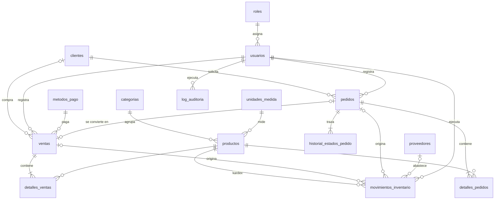

# Base de datos SIMO (SCRUM-84)

Esquema relacional consolidado en PostgreSQL (desarrollado para 18, probado en 16). Reemplaza los scripts sueltos de `backend/scripts/` e incorpora el inventario dual Bodega/Almacén.

```
db/
├── 00_init.sh              # ejecuta migraciones + seeds (lo usa Docker)
├── migrations/             # esquema, en orden; se pueden re-ejecutar sin error
│   ├── 001_base.sql            funciones compartidas, zona horaria
│   ├── 002_seguridad.sql       roles, usuarios, empresa
│   ├── 003_catalogo.sql        unidades_medida, categorias, productos
│   ├── 004_clientes_pedidos.sql clientes, pedidos, detalles, historial de estados
│   ├── 005_ventas.sql          metodos_pago, ventas, detalles_ventas
│   ├── 006_inventario.sql      proveedores, movimientos_inventario, vista v_kardex
│   ├── 007_auditoria.sql       log_auditoria
│   ├── 008_ingreso_bodega.sql  función fn_registrar_ingreso_bodega (HU-05)
│   ├── 009_clientes.sql        búsqueda por documento y documento inalterable (HU-09)
│   ├── 010_sesiones.sql        tokens invalidados por cierre de sesión (SCRUM-17)
│   ├── 011_compras.sql         compras a proveedor y sp_confirmar_compra (SCRUM-45)
│   ├── 012_saldo_kardex.sql    fn_kardex_producto y fn_validar_kardex (SCRUM-132)
│   ├── 013_indices_ventas.sql  índices B-tree de cobertura para ventas (SCRUM-133)
│   ├── 014_ajustes_inventario.sql fn_registrar_ajuste y orden del Kardex con concurrencia (SCRUM-42)
│   ├── 015_pedidos.sql         total y reglas de las líneas de pedido (SCRUM-81)
│   ├── 016_estados_pedido.sql  fn_cambiar_estado_pedido: stock al preparar y al cancelar (SCRUM-61)
│   ├── 017_pedido_a_venta.sql  fn_convertir_pedido_en_venta, sin mover stock (SCRUM-62)
│   ├── 018_cancelacion_pedidos.sql cancelación según CU-13: mensajes y saldo reversado en auditoría (SCRUM-100)
│   ├── 019_limpiar_funciones_pedido_antiguas.sql elimina fn_salida_pedido y fn_reverso_pedido (sin uso)
│   ├── 020_ventas_pos.sql      fn_registrar_venta, fn_anular_venta y referencia de pago (HU-07, CU-11)
│   ├── 021_traslados.sql       fn_registrar_traslado Bodega -> Almacén (HU-06)
│   ├── 022_pagos_digitales.sql pagos_digitales y fn_conciliar_pago (SCRUM-78)
│   ├── 023_auditoria_precios.sql trigger CAMBIO_PRECIO en log_auditoria (SCRUM-77)
│   ├── 024_indices_pedidos.sql índice de pedidos por fecha y auditoría de índices (SCRUM-168)
│   ├── 025_auditoria_kardex.sql fn_auditar_documentos_kardex y sp_auditar_kardex (SCRUM-169)
│   └── 026_integridad_historial.sql ventas y líneas inalterables, API sin DELETE (SCRUM-174)
├── seeds/
│   └── 001_datos_desarrollo.sql  usuarios de prueba, empresa, categorías, productos
├── carga/
│   ├── poblar_masivo.sql         datos masivos coherentes para pruebas de carga (SCRUM-131, 170)
│   ├── consultas_rendimiento.sql consultas de referencia con EXPLAIN ANALYZE (SCRUM-133)
│   └── medir_api.sh              tiempos de respuesta de los endpoints (SCRUM-168)
└── tests/
    ├── 001_reglas_esquema.sql    42 pruebas de reglas de negocio (no deja datos)
    ├── 002_ingreso_bodega.sql    19 pruebas del ingreso a Bodega (no deja datos)
    ├── 003_compras.sql           17 pruebas de compras y sp_confirmar_compra (no deja datos)
    ├── 004_saldo_kardex.sql      12 pruebas del saldo y la valorización del Kardex (no deja datos)
    ├── 005_ajustes.sql           20 pruebas de ajustes manuales y su auditoría (no deja datos)
    ├── 006_pedidos.sql           12 pruebas de las líneas y el total de los pedidos (no deja datos)
    ├── 007_estados_pedido.sql    17 pruebas del ciclo de estados con descuento y reverso de stock (no deja datos)
    ├── 008_pedido_a_venta.sql    13 pruebas de la conversión de pedido entregado en venta (no deja datos)
    ├── 009_cancelacion_pedidos.sql 11 pruebas de la cancelación según CU-13 (no deja datos)
    ├── 010_ventas_traslados_pagos.sql 47 pruebas de venta, anulación, traslados, pagos y precios (no deja datos)
    ├── 011_auditoria_kardex.sql   15 pruebas de la auditoría completa del Kardex (no deja datos)
    └── 012_integridad.sql         26 pruebas de llaves foráneas, protecciones y permisos (no deja datos)
```

## Cómo crear la base

**Con Docker** (desde `backend/`): la primera vez que se crea el volumen, PostgreSQL ejecuta `00_init.sh` solo.

```bash
docker compose up -d --build
```

Para borrar la base y recrearla con cambios en las migraciones:

```bash
docker compose down -v && docker compose up -d --build
```

**Sin Docker (pgAdmin / psql):** crear la base `simo_retail` y ejecutar en orden los archivos de `migrations/` y luego los de `seeds/`. O bien:

```bash
POSTGRES_USER=postgres POSTGRES_DB=simo_retail sh db/00_init.sh
```

**Pruebas:**

```bash
psql -v ON_ERROR_STOP=1 -U postgres -d simo_retail -f db/tests/001_reglas_esquema.sql
```

Usuarios de prueba (seed): `admin@`, `gerente@`, `inventario@` y `vendedor@simo.local`, contraseña `Simo2026*`.

## Modelo entidad-relación



## Reglas que garantiza la base de datos

| Regla | Cómo |
|---|---|
| Stock nunca negativo (RNF-04) | `CHECK (stock_bodega >= 0)` y `CHECK (stock_almacen >= 0)` en `productos` |
| Compras solo entran a Bodega (CU-05) | `chk_movimiento_ubicaciones` en `movimientos_inventario` |
| Traslado solo Bodega → Almacén (CU-06) | `chk_movimiento_ubicaciones` |
| Ajuste manual con justificación (RF-10) | `chk_movimiento_motivo_ajuste` |
| Kardex inalterable | trigger bloquea UPDATE/DELETE/TRUNCATE en `movimientos_inventario` |
| Flujo secuencial de pedidos (RN-04) | trigger `fn_validar_transicion_pedido` |
| Fecha, hora y usuario de cada estado (RF-18) | trigger llena `historial_estados_pedido` |
| Cancelación con causa (CU-13) | `chk_historial_motivo_cancelacion` |
| Anulación con autorizador y causa (CU-11) | `chk_ventas_anulacion` |
| Un pedido genera como máximo una venta (RF-20) | `UNIQUE (ventas.id_pedido)` |
| Totales coherentes | `chk_ventas_total`, `chk_*_subtotal` |
| Log de auditoría inalterable (RF-24) | triggers + `REVOKE` en `log_auditoria` |
| Documento del cliente inalterable (CU-09 RB-1) | trigger `fn_documento_cliente_inalterable` (SQLSTATE `SM008`) |
| Venta inalterable: solo se anula, una vez, y nunca se borra | trigger `fn_venta_inalterable` (SQLSTATE `SM034`, migración 026) |
| Líneas de venta inalterables | trigger bloquea UPDATE/DELETE/TRUNCATE en `detalles_ventas` (026) |
| Pago digital no se borra (soporte de la conciliación) | trigger en `pagos_digitales` (026) |
| Nada con historial se borra | llaves `ON DELETE RESTRICT` + la API sin permiso `DELETE` (026) |

### Integridad del historial (SCRUM-174)

Las 34 llaves foráneas del esquema se auditaron y `tests/012_integridad.sql` lo verifica
sobre el catálogo de PostgreSQL, así que falla si alguien cambia una después:

- **Toda llave hacia `ventas`, `clientes`, `productos`, `usuarios`, `pedidos` y `compras` es
  `ON DELETE RESTRICT`**: ninguno se puede borrar mientras tenga historial (PostgreSQL responde
  `23001`). Sin historial sí se pueden borrar, para corregir un error de digitación.
- Las únicas `CASCADE` son las líneas de compra y de pedido, y solo actúan sobre documentos que
  no se pueden borrar: una compra confirmada tiene movimientos y todo pedido tiene historial.
- Ninguna llave usa `SET NULL`: nunca se pierde a quién pertenece un registro.

La revisión encontró tres huecos que cerró la migración 026:

| Hueco | Riesgo | Corrección |
|---|---|---|
| Líneas de venta sin protección | Alterar una venta ya cobrada; borrar una venta que viene de un pedido quitando primero sus líneas | `detalles_ventas` inalterable, como el Kardex |
| Ventas modificables | Cambiar el total o "desanular" una venta (pasaba los `CHECK` y dejaba el stock devuelto dos veces) | Solo se permite la anulación, una vez; `fn_registrar_venta` ahora inserta la venta ya completa |
| Pagos digitales borrables | Perder el rastro de la conciliación | Los pagos no se borran |

Además, el rol de la API (`simo_app`) ya no tiene permiso `DELETE` en ninguna tabla con
historial: la API nunca borra, inactiva. Lo conserva solo en `usuarios` y `jwt_blacklist`.

## Convenciones para el backend

1. **Usuario responsable.** Antes de modificar `pedidos`, dentro de la misma transacción:
   ```js
   await client.query("SELECT set_config('simo.id_usuario', $1, true)", [String(req.user.id_usuario)]);
   await client.query("SELECT set_config('simo.motivo', $1, true)", [motivo]); // al cancelar
   ```
   Si falta, la base rechaza el cambio.
2. **El stock no se edita a mano.** `stock_bodega` y `stock_almacen` cambian solo junto con una fila en `movimientos_inventario`, en la misma transacción, bloqueando el producto con `SELECT ... FOR UPDATE`. El ingreso a Bodega ya lo hace `fn_registrar_ingreso_bodega` (migración 008); los traslados, ventas y ajustes seguirán el mismo patrón, con errores de negocio identificados por SQLSTATE de clase `SM`.
3. **Deducción en cascada.** Una línea de venta o pedido genera hasta dos movimientos `SALIDA_*` (primero `ALMACEN`, luego `BODEGA`). La anulación o cancelación crea un `REVERSO_*` por cada uno, hacia la misma ubicación.
4. **Venta desde pedido.** Se inserta con `id_pedido` y **no** genera movimientos (el stock ya salió al pasar a `EN_PREPARACION`). Validar en el endpoint que el pedido esté `ENTREGADO`.
5. **Auditoría.** Ajustes, anulaciones y cancelaciones insertan en `log_auditoria` dentro de la misma transacción.
6. **Precio de compra.** No devolver `precio_compra` ni `costo_unitario` a usuarios con rol `VENDEDOR`.
7. **Tipos.** `pg` devuelve `NUMERIC` como texto (`"12.500"`): convertir en la API si el frontend espera números.
8. **Roles.** Usar `roles.codigo` (`ADMIN`, `GERENTE`, `INVENTARIO`, `VENDEDOR`) en el JWT y en `requireRole()`.

## Kardex: consulta y auditoría (SCRUM-132)

```sql
-- Kardex de un producto (opcionalmente entre dos fechas), con saldos por ubicación
-- y valorización por costo promedio ponderado
SELECT * FROM fn_kardex_producto(1);
SELECT * FROM fn_kardex_producto(1, '2026-10-01', '2026-10-31');

-- Auditoría: ¿el saldo del Kardex coincide con el stock de cada producto?
SELECT * FROM fn_validar_kardex() WHERE NOT consistente;

-- Auditoría de documentos (025): ¿cada movimiento corresponde a su documento?
SELECT * FROM fn_auditar_documentos_kardex();

-- Las dos juntas. Con p_estricto => true falla (SM033) si hay diferencias:
-- es la verificación de la restauración de respaldos y de la integración continua.
CALL sp_auditar_kardex();
CALL sp_auditar_kardex(p_estricto => true);
```

### Qué valida la auditoría de documentos (SCRUM-169)

El saldo de un producto puede cuadrar consigo mismo y aun así estar mal: si una venta
descontara 3 unidades cuando su línea dice 2, los saldos seguirían cuadrando. Por eso
`fn_auditar_documentos_kardex()` compara cada movimiento con el documento que lo originó:

| Documento | Regla |
|---|---|
| Venta POS | Las salidas por producto suman lo que dicen sus líneas |
| Venta de un pedido | No tiene salidas propias (el pedido ya descontó: tenerlas sería descontar dos veces) |
| Venta anulada / completada | Anulada: los reversos devuelven a cada ubicación lo que salió de ella. Completada: no tiene reversos |
| Pedido | Si pasó por `EN_PREPARACION`, sus salidas suman sus líneas; si no, no tiene salidas y no puede estar en preparación, listo ni entregado |
| Pedido cancelado / no cancelado | Cancelado: los reversos devuelven a cada ubicación lo que salió. Otro estado: sin reversos |
| Compra | Confirmada: las entradas suman sus líneas. Borrador: sin entradas |
| Ajuste manual | Tiene su registro `AJUSTE_INVENTARIO` en el log de auditoría |

Cada observación trae documento, producto, ubicación, problema, cantidad esperada y
registrada. Con 2.000 productos y 155.000 movimientos, la auditoría completa tarda 0,8 s.
Se ejecuta todas las noches a las 00:30 (`cron/auditarKardex.js`) y se consulta en
`GET /api/inventory/kardex-audit`.

## Población masiva para pruebas de carga (SCRUM-131, SCRUM-170)

`carga/poblar_masivo.sql` genera productos, clientes y ventas simuladas **respetando
las reglas del sistema**, de modo que el resultado es indistinguible de una operación real:

1. **Compra inicial confirmada** a un proveedor (`compras` + `detalles_compras`), con un
   movimiento `ENTRADA_COMPRA` por línea enlazado a la compra (`id_compra`).
2. **Traslado** de una parte del stock de Bodega al Almacén.
3. **Ventas** repartidas en los últimos 12 meses (1 a 5 productos, 70 % con cliente, 10 %
   con descuento). Cada línea descuenta primero del Almacén y luego de Bodega (RN-02) con
   su `SALIDA_VENTA` y el saldo correcto; las ventas por Nequi, Daviplata o transferencia
   llevan referencia y crean su pago digital pendiente (022).
4. **Anulaciones** del 2 % de las ventas con `fn_anular_venta` (reverso en el Kardex y
   registro en `log_auditoria`).
5. **Conciliación** de los pagos digitales con `fn_conciliar_pago`: 85 % conciliados,
   5 % rechazados, el resto pendiente.
6. **Verificación**: `fn_validar_kardex()` (saldos) y `fn_auditar_documentos_kardex()`
   (cada movimiento contra su compra o venta) limitadas a los datos generados. Si hay
   cualquier diferencia, **se revierte toda la carga**.

```bash
# sobre una base local con migraciones y seed aplicados
psql -d simo_retail -v productos=2000 -v clientes=5000 -v ventas=50000 -f db/carga/poblar_masivo.sql
```

Medido en Docker (PostgreSQL 18) sobre una base nueva con migraciones y seed:

| Parámetros (productos / clientes / ventas) | Ventas | Anuladas | Líneas de venta | Pagos digitales | Movimientos | Tiempo |
|---|---|---|---|---|---|---|
| 50 / 100 / 1.000 | 1.000 | 20 | 2.981 | 513 | 3.178 | 0,7 s |
| 1.000 / 2.000 / 10.000 (por defecto) | 9.999 | 207 | 29.762 | 5.076 | 32.957 | 6,5 s |
| 2.000 / 5.000 / 50.000 | 49.995 | 1.004 | 150.326 | 24.981 | 158.530 | 28 s |

Con la carga grande (≈ 360.000 registros) `CALL sp_auditar_kardex(p_estricto => true)`
pasa sobre toda la base, las 141 pruebas de integración pasan contra ella y todos los
endpoints de `carga/medir_api.sh` responden en 0,11 s o menos.

- Los datos son reproducibles (`setseed`) y se reconocen por el SKU `CARGA-…`, documentos
  de cliente `99…`, la compra y los movimientos con documento `CARGA-…` y el motivo de
  anulación "Anulación simulada para pruebas de carga".
- Como el Kardex es inalterable, estos datos **no se pueden borrar**: el script se niega a
  correr dos veces en la misma base y a correr en la base compartida de Neon (`neondb`)
  salvo que se pase `-v forzar=si`. Úselo en una base local o en una rama de Neon.

## Índices de ventas (SCRUM-133)

Medido con `carga/consultas_rendimiento.sql` sobre 49.996 ventas y 149.953 líneas
(PostgreSQL 18, mejor de 3 ejecuciones, `EXPLAIN ANALYZE`):

| Consulta | Antes | Plan antes | Después | Plan después |
|---|---|---|---|---|
| Q1 Historial del último mes (todas las ventas) | 7,16 ms | Seq Scan ventas | 0,57 ms | Index Scan `idx_ventas_fecha` |
| Q2 Total por día de la semana (dashboard) | 0,26 ms | Index Scan | 0,22 ms | **Index Only Scan** `idx_ventas_fecha_completadas` |
| Q3 Productos más vendidos del mes | 8,73 ms | Seq Scan 150.000 líneas | ~4,5 ms | Index Only Scan `uq_detalles_ventas_producto` |
| Q4 Historial de ventas de un producto | 0,24 ms | Bitmap Heap Scan | 0,25 ms | **Index Only Scan** `idx_detalles_ventas_producto` |
| Q5 Unidades vendidas de un producto (trimestre) | 0,13 ms | Bitmap Heap Scan | 0,12 ms | **Index Only Scan** `idx_detalles_ventas_producto` |
| Q6 Últimas 20 ventas | 5,09 ms | Seq Scan + Sort | 0,015 ms | Index Scan Backward `idx_ventas_fecha` |

- Las consultas por fecha sin filtrar estado (Q1, Q6) eran las críticas: crecían con
  el tamaño de la tabla; ahora leen solo las filas del rango.
- Q4 y Q5 ya eran rápidas; el índice de cobertura evita además visitar la tabla.
- La migración fija `random_page_cost = 1.1` (discos SSD) para la base; con el valor
  por defecto (4) el planificador no usaba el índice en Q3.
- Los índices se mantienen solos; tras cargas masivas conviene `VACUUM ANALYZE`
  para que los Index Only Scan no tengan que revisar la tabla.

## Auditoría de índices y tiempos de la API (SCRUM-168)

Con el esquema completo del Sprint 3 se midieron los **endpoints reales** (no solo las
consultas) con `carga/medir_api.sh` sobre 2.000 productos, 5.000 clientes, 49.995 ventas,
150.326 líneas, 155.579 movimientos, 24.981 pagos digitales y 200.000 pedidos.

**Columnas clave de la historia:** ya estaban indexadas — `productos.sku` (UNIQUE, 003),
`ventas.fecha_venta` (013) y `pedidos.estado` (004).

**Índice nuevo (migración 024):** `idx_pedidos_fecha_solicitud (fecha_solicitud DESC, id_pedido DESC)`,
en el orden de la lista de pedidos. Era la única consulta frecuente que recorría la tabla
completa y crece con el tiempo:

| Pedidos por fecha (200.000 pedidos) | Sin índice | Con índice |
|---|---|---|
| Último mes, ordenados | 17,7 ms (Seq Scan) | 0,45 ms (Index Only Scan) |
| Última semana con cliente | 10,8 ms (Parallel Seq Scan) | 1,6 ms (Bitmap Index Scan) |

**Llaves foráneas sin índice que se dejan así a propósito:** las 14 que apuntan a usuarios,
métodos de pago, unidades y proveedores. Esas filas nunca se borran (se inactivan), así que
un índice solo encarecería cada inserción en el Kardex, ventas y pedidos.

**Lo que sí pasaba de 1 segundo no era falta de índices:**

| Endpoint (primera vez, sin caché) | Antes | Después | Causa y corrección |
|---|---|---|---|
| `GET /api/reports` (consola) | 3,6 s | 0,003 s | Generaba los 9 archivos para dar su tamaño; ahora responde con la caché y genera en segundo plano |
| Reporte de movimientos (Excel) | 1,26 s | 0,15 s | `toLocaleString` creaba un formateador por fecha (570 ms en 12.500 fechas); ahora se reutiliza uno |
| `GET /api/orders` sin filtro | 1,1 s · 77 MB | 0,22 s · 15 MB | Devolvía la historia completa; ahora 180 días + todos los abiertos |
| `GET /api/dashboard/alerts` (Gerente) | 0,57 s · 40 MB | 0,01 s · 0,6 MB | Devolvía todos los pedidos vencidos; ahora los 100 más atrasados y el total |

Con eso, **todos los endpoints responden en menos de 0,25 s** con ese volumen (el más lento es
la lista de pedidos sin filtro). Resultado completo: informe de SCRUM-168.

**Hallazgo en la carga masiva:** el script de SCRUM-131 había quedado cuadrático (50.000
ventas: 3,5 min en lugar de 22 s). El `ANALYZE` del final de la migración 013 deja
registrado que `ventas` está vacía; durante una carga en una sola transacción el
planificador sigue creyéndolo y cada verificación de llave foránea recorre la tabla entera.
El script ahora actualiza las estadísticas cada 2.000 ventas (50.000 ventas: 26 s). En
producción no ocurre: el autovacuum de PostgreSQL vuelve a analizar las tablas a medida que
crecen.
